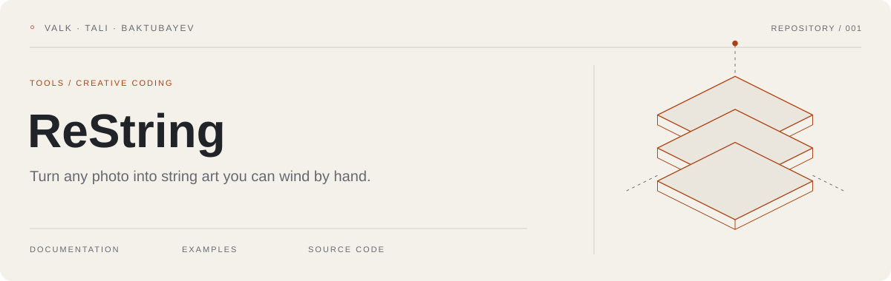
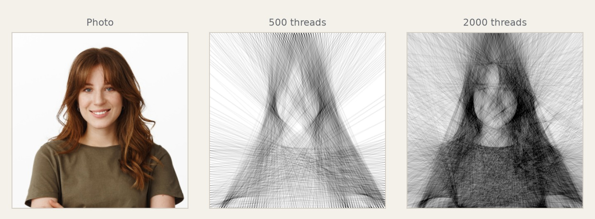
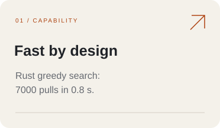
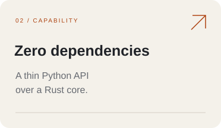
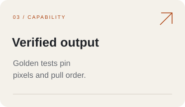

[](https://github.com/InzGIBA/ReString/actions/workflows/ci.yml)

<picture>
  <source media="(prefers-color-scheme: dark)" srcset="assets/hero-dark.svg">
  <source media="(prefers-color-scheme: light)" srcset="assets/hero-light.svg">
  
</picture>

Feed in a portrait. The greedy search picks one thread at a time, and each pull moves the canvas measurably closer to the photo. The output is the picture one uncut thread draws around the nails, plus the nail-by-nail winding order. Black and white uses one thread. Color runs pick a palette: the pure RGB triple, CMY, CMYK or a JSON list of the floss colors you own.

[Quick start](#quick-start) · [Usage](#usage) · [Tuning](#tuning) · [Development](#development) · [Contributing](#contributing) · [License](#license)

Try it in the browser: the [playground](https://inzgiba.github.io/ReString/) runs the same core as a wasm module. Drop a photo, no install. The page deploys from `web/` (`.github/workflows/pages.yml`).

## Overview

- **For:** makers winding physical boards, machine and plotter owners, and anyone who wants a digital string-art render.
- **Input:** a PNG or JPEG photo; face-centered portraits work best.
- **Output:** a PNG render of the thread pattern; the Python API also returns the continuous nail-by-nail pull order.
- **Scope:** greedy search on a 300 px working grid, five nail-layout families, black-and-white and color palettes, `.restring` project files, printable winding posters, GIF animations and a physical thread model. Building from source requires a Rust toolchain, there is no pure-Python fallback.



One run of the CLI: the same portrait at 1000 threads around 300 nails and 3000 threads around 598 nails (`--rect -s 0.05`).

The project started as a 2020 university course assignment by Kaspar Valk, Kert Tali and Almas Baktubayev. The [project poster](https://raw.githubusercontent.com/InzGIBA/ReString/main/docs/Algoritmika%20poster%20puhtand.pdf) describes the original idea.

## Features

<picture>
  <source media="(prefers-color-scheme: dark)" srcset="assets/feature-01-dark.svg">
  
</picture>
<picture>
  <source media="(prefers-color-scheme: dark)" srcset="assets/feature-02-dark.svg">
  
</picture>
<picture>
  <source media="(prefers-color-scheme: dark)" srcset="assets/feature-03-dark.svg">
  
</picture>

- **One uncut thread**: the pull order is continuous by construction, so you wind a single thread by hand or machine.
- **Real thread colors**: black-on-white, white-on-black, or a palette. The built-ins are RGB, CMY and CMYK, or load a JSON list of the floss colors you own. CMYK measures 42 to 45 percent better than RGB at an equal budget.
- **Custom boards**: polygon, star, multi-ring and SVG-outline layouts via `--layout star:5:0.55`, plus non-square aspect crops ([layouts guide](docs/layouts.md)).
- **From photo to board**: save a `.restring` project, re-render in milliseconds, print a numbered-nail poster with the thread length in meters, watch the winding as a GIF.
- **Measured, not guessed**: every flag has a degradation curve behind it in the [tuning guide](docs/tuning.md).

## Quick start

### Install

```bash
pip install restring
```

Wheels cover linux (x86_64, aarch64), macos (x86_64, arm64) and windows (x86_64) on CPython 3.12 and newer. No Rust toolchain needed. Building from source needs uv and Rust, see [Development](#development).

### Run your first example

```bash
restring -i portrait.png -o out.png --rect -n 2 -l 3000   # best quality, ~1.4 s
```

Expected result:

```text
[...] [restring.cli] [INFO]: Nails amount: 598
```

`out.png` now holds the rendered thread pattern.

## Usage

### Basic example

Three presets cover most jobs (timed on a 24-core Linux box):

```bash
# fast preview, ~0.3 s
restring -i portrait.png -o out.png --rect -l 300

# balanced, ~0.6 s
restring -i portrait.png -o out.png --rect -n 4 -l 2000

# maximum measured quality, ~1.4 s
restring -i portrait.png -o out.png --rect -n 2 -l 3000
```

### CLI reference

| Flag | Meaning | Default |
|---|---|---|
| `-i <path>` | input image (PNG or JPEG) | required |
| `-o <path>` | output PNG | `output.png` |
| `-d <int>` | output side length in pixels | 300 |
| `-n <int>` | nail step for the circle and rect layouts. Smaller values place more nails. Minimum 1 | 4 |
| `--layout <spec>` | nail layout: `circle`, `rect`, `polygon:sides[:count]`, `star:points:inner[:count]`, `rings:r:count,r:count`, `svg:file.svg[:count]`, optional `@aspect` suffix for non-square boards. Custom layouts take counts instead of `-n` | circle |
| `-l <int>` | iteration budget. Without the flag the search stops after 3 pulls with no improvement | run to exhaustion |
| `-s <float>` | thread strength at export, 0..1. Leave unset and the run derives the value from the actual pull count: k/L with k=104, clamped to 0.03..0.2, within 2 percent of the hand-tuned optimum at the measured budgets | auto |
| `-r <int>` | scan a fixed random subset of candidates each iteration. Trades quality for speed. Good values sit near 100 to 150 | all nails |
| `-r1 <float>` | vertical nail ellipse multiplier | 1 |
| `-r2 <float>` | horizontal nail ellipse multiplier | 1 |
| `--rect` | nails on the rectangle border instead of the circle. Better for square portraits, about 2x lower error | circle |
| `--rgb` | colored output with three interleaved pure RGB threads | black and white |
| `--palette <name|file>` | thread palette: `rgb`, `cmy`, `cmyk`, or a JSON file of `{"name", "rgb": [r, g, b]}` colors (cap 8 threads). CMYK measures 42 to 45 percent better color MSE than RGB at an equal budget | off |
| `--wb` | white thread on a black canvas | black on white |
| `--weight <float>` | importance weighting. A Gaussian weight map steers threads toward the image center, where the viewer looks. Suggested range 1.5 to 5.0. Portrait subjects only, about 25 percent more scan time | off |
| `--min-chord <px>` | candidate filter: chords shorter than the distance in working-grid pixels are banned. Portrait measurement: the greedy never picks short chords, the filter only degrades MSE past 250 px. Intended for sparse custom layouts | off |
| `--project-out <path>` | save the nail layout and pull order as a `.restring` project alongside the PNG | off |
| `--project <path>` | re-render from a `.restring` project instead of an image: skips the search, applies the current `-s` and `-d` | off |
| `--anim <path>` | with `--project`: animated GIF of the winding sequence. `--anim-frames` sets the frame count, 180 is about 6 s at 30 fps. A 2000-pull project at the default 600 px export lands near 45 MB; `-d 450` brings it to about 28 MB, `-d 380` under 25 MB | off |
| `--realistic` | physical thread model: threads of `--thread-width` mm (default 0.2) on a `--canvas-size` mm board (default 400). At exports well above 300 px the 0.3 mm width beats the hairline by 35 percent MSE. The search never changes | hairline |
| `--rollback` | truncate a stagnating run to its best-error prefix. Measured no-op: the search never applies non-improving pulls, so nothing rolls back ([measurement](docs/research/rollback-experiment.md)) | off |
| `--metrics <path.json>` | write a quality report: MSE, correlation, plain and blurred SSIM against the working target, plus pulls, nails and elapsed time. Generate mode only | off |
| `--thread-width <mm>` | thread diameter for `--realistic`. Birsak used 0.15, typical polyester sits near 0.2 | 0.2 |
| `--canvas-size <mm>` | board size: the poster printing size (default 260 for `--poster`) or the physical size behind `--realistic` (default 400) | per feature |

Nails sit evenly on the perimeter. The circle starts at 9 o'clock and runs clockwise. The rectangle starts at the top left corner. The pull order is continuous by construction, so you wind one uncut thread.

### Save and re-render

The project file keeps the nail layout and the pull order in plain JSON, so a result re-renders in milliseconds without a search and any tool can read the winding sequence:

```bash
restring -i portrait.png -o out.png --rect -l 2000 --project-out result.restring
restring --project result.restring -o out2.png   # byte-identical re-render
```

The current `-s` and `-d` apply at re-render time. Schema and compatibility promise: [docs/project-format.md](docs/project-format.md).

### Wind it for real

Turn a result into a printable poster: numbered nails, the footer with the nail count, pull count and total thread length in meters.

```bash
restring -i portrait.png -o out.png --rect -l 2000 --project-out result.restring --poster poster.svg
restring --project result.restring --poster poster.svg --canvas-size 300
```

Print at 100 percent scale, hammer the nails on the board outline, wind. Printing checklist and thread buying guidance: [docs/winding.md](docs/winding.md).

### As a library

```python
from restring import GenerateOptions, generate

result = generate("portrait.png", GenerateOptions(layout="rect", pulls=2000))
result.image.save_png("out.png")
print(result.stats.pulls_per_thread)
```

The full options table, the Result fields and the deprecated 1.x names: [docs/api.md](docs/api.md). Images travel as `_core.Image` objects; the pixel data stays in Rust memory, so calls pass references instead of copying arrays.

## Tuning

`-s` is fitted for you: the run derives the export strength from the actual pull count (104/L clamped to 0.03..0.2) and lands within 2 percent of the hand-tuned optimum at the measured budgets. The working simulation darkens each pull with strength 0.05; the export accumulates with strength `-s`. When `-s` is too high for the thread count, the render reaches its target halfway, then overshoots and darkens. Manual `-s` values stay for special cases, see the tuning guide.

| Flag | Recommended | Rule |
|---|---|---|
| `--rect` | always on for square portraits | 1.8 to 2.7x lower error than the circle |
| `-s` | leave unset, auto fits the pull count | measured optimum scales as 1 over thread count, k=104 clamped 0.03 to 0.2 |
| `-l` | up to saturation, about 2500 to 2900 threads | beyond saturation the search finds no improvements |
| `-n` | 4 for the knee, 2 for maximum quality | 844 circle nails buy 6 percent error reduction at 4x the cost |
| `-r` | 100 to 150 while exploring, drop for the final run | k=100 saves 40 percent of the time for 15 percent error |
| `-d` | 300 | exporting above the working grid hurts |
| `--weight` | 3.0 for portraits, off for other subjects | center MSE falls 24 to 28 percent, global MSE rises 3 percent |
| `--min-chord` | off | the greedy never picks short chords, thresholds bite past 230 px at up to 24 percent MSE cost |

Every flag, the numbers behind the rules and the degradation curves: [docs/tuning.md](docs/tuning.md).

## Development

```bash
git clone git@github.com:InzGIBA/ReString.git
cd ReString
uv sync
```

Requirements: [uv](https://docs.astral.sh/uv/getting-started/installation/) and a Rust toolchain with a C linker for cargo. uv fetches Python 3.14 and compiles the core on first sync. No system C compiler (minimal WSL or container)? Use zig as the cargo linker — the recipe lives in [docs/architecture.md](docs/architecture.md#build).

Source checkouts prefix every command with `uv run`, for example `uv run restring -i portrait.png -o out.png --rect -l 300`.

### Checks

```bash
uv run pytest                   # 211 tests, ~11 s
uv run ruff check .
uv run python scripts/benchmark.py --label before   # or after, then --plot
uv run python scripts/make_gallery.py               # regenerate docs/img/gallery.png
```

CI runs the same checks on every push to main and every pull request, on linux, macos and windows (`.github/workflows/ci.yml`). A `v*` tag builds wheels for three platforms, publishes to PyPI and opens the GitHub Release (`.github/workflows/release.yml`).

## Documentation

| Document | Contents |
|---|---|
| [docs/architecture.md](docs/architecture.md) | how the pipeline works, the Rust core, correctness model, performance, build, wasm target |
| [docs/api.md](docs/api.md) | the 2.0 facade: `GenerateOptions`, `Result`, deprecated 1.x names |
| [docs/tuning.md](docs/tuning.md) | every flag, degradation curves, recommended values, presets |
| [docs/layouts.md](docs/layouts.md) | layout specs, the clockwise ordering rule, non-square boards |
| [docs/project-format.md](docs/project-format.md) | the `.restring` schema and the compatibility promise |
| [docs/winding.md](docs/winding.md) | printing checklist, reading the poster, buying thread |
| [docs/history.md](docs/history.md) | the migration story: stages, numbers, rejected hypotheses |
| [docs/research/](docs/research/) | twelve experiment docs with the numbers behind every verdict, plus the related-work survey |

## Roadmap

The 2027 backlog lives in [tasks/](tasks/README.md): 20 self-contained work orders with acceptance criteria, and the dead-end table of ideas measured and closed. Answered in 2.0:

- [x] Re-run the RGB sweeps: working strength 0.05 adopted, 13 to 17 percent better MSE ([measurement](docs/research/rgb-channels-experiment.md)).
- [x] Test the working grid above 300 px: keep 300, under 3 percent MSE at up to 2.4x time ([measurement](docs/research/grid-scale-experiment.md)).

## Contributing

Issues and pull requests are welcome. Templates structure both: bug reports carry the command line and image, feature requests check the measured dead ends, research ideas state a pre-registered success bar, and the PR template asks for the measurement or test evidence.

Wound a physical board? Post the photos under the "show and tell" label. Physical outputs are the best advertisement a string-art project gets. The example gallery ([examples/gallery/](examples/gallery/)) shows the configuration families and the commands behind every tile.

1. Describe the problem or the proposed improvement.
2. Make a focused change.
3. Add or update relevant tests and documentation.
4. Run the checks above and open a pull request.

## License

MIT. See [LICENSE](LICENSE).

## Photo credits

Portrait fixtures in `tests/data/` are square face-centered crops of studio photos provided for this project. The demo image above uses the `portrait_female.png` fixture. Earlier fixtures came from [Unsplash](https://unsplash.com/s/photos/people) under the [Unsplash License](https://unsplash.com/license).
