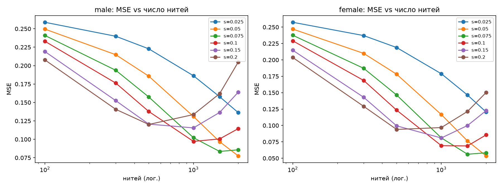
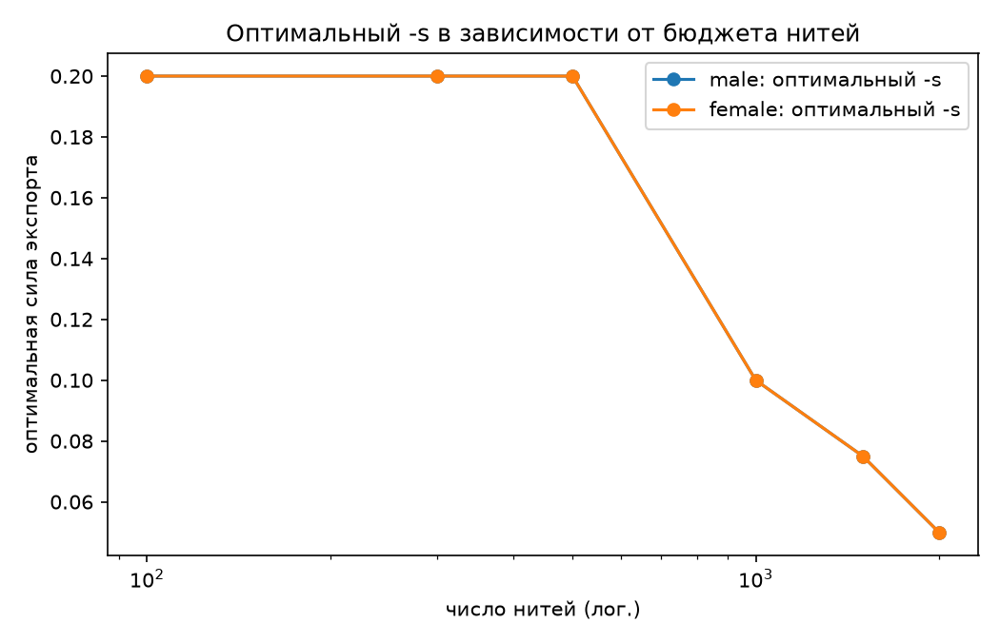
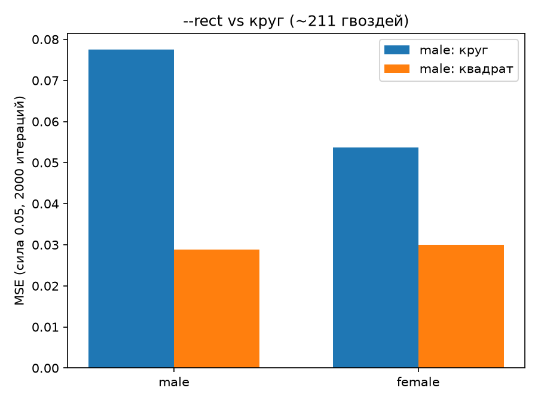
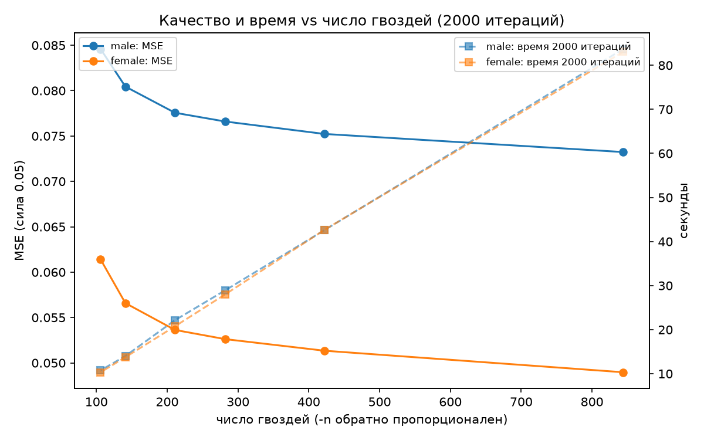
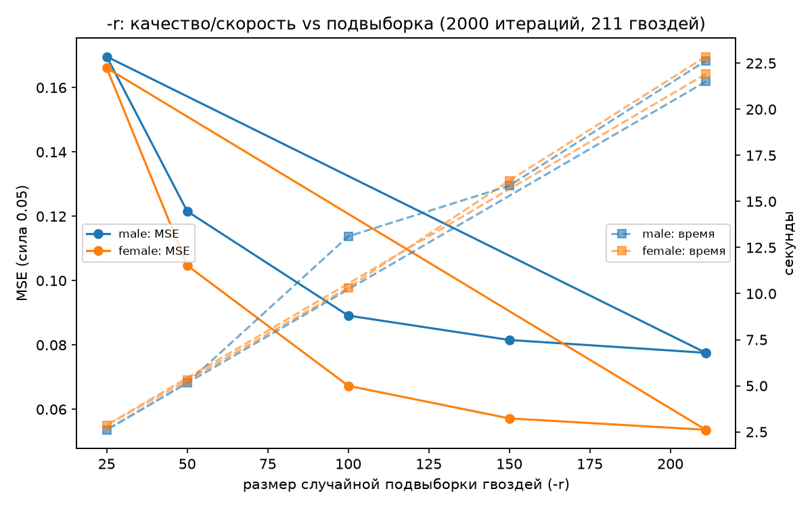
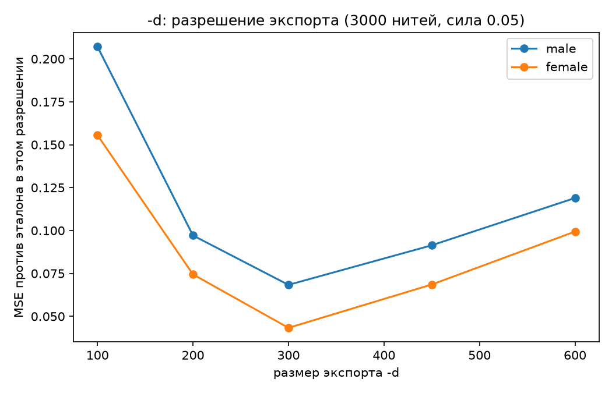
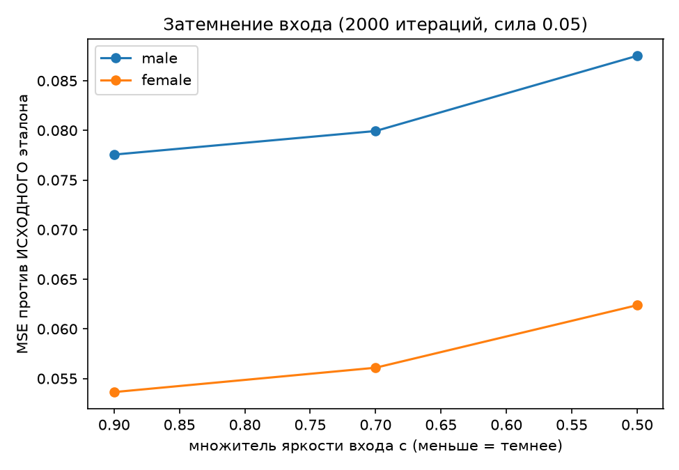

# Тюнинг параметров: лучшие значения и кривые деградации

Полный проход по каждому параметру CLI на новых лицевых фикстурах
(`tests/data/portrait_{male,female}.png`, квадратные кропы 2048² с лицом по центру).
Методика: рабочий конвейер как в CLI (300×300, круг 211 гвоздей, если не указано иное),
эталон = `rgb2gray(img)*0.9`, метрика — MSE рендера против эталона; жадная
последовательность префикс-детерминирована, поэтому свип `-l` использует один прогон
на 7000 итераций. Воспроизведение: `uv run python scripts/parameter_sweep.py --sweep <имя>`,
данные в `docs/img/params/*.json`.

## Сводка: лучшие значения

| Параметр | Лучшее значение | Правило |
|---|---|---|
| `--rect` (раскладка) | **включать всегда для квадратных портретов** | MSE 0.029–0.030 против 0.054–0.078 у круга (в 1.8–2.6× лучше) |
| `-s` | **0.05 при `-l ≥ 1000`**; 0.1 при ~500–1000; 0.15–0.2 при ≤300 (превью) | оптимум ∝ 1/числу нитей; см. график |
| `-l` | **до насыщения**: ~2900 нитей при 211 круглом гвозде; с `--rect`/`-n 2` — больше | дальше жадный не находит улучшений |
| `-n` | **4 (дефолт)** — колено кривой; 2–3 для максимума | 844 гвоздя дают лишь −6% MSE за 4× времени |
| `-r` | **100–150 для итераций, финал — без `-r`** | k=100: −40% времени за +15% MSE |
| `-d` | **300 (дефолт)** | экспорт выше рабочей сетки ухудшает картину |
| Затемнение входа | **оставить 0.9 (текущее)** | «темнее — лучше» из статьи Birsak НЕ переносится в нашу модель |

## 1. Число нитей `-l` и сила экспорта `-s`



Насыщение алгоритма на лицевых кропах: 7000 итераций → **2901/2894 улучшающих нити**
(59% итераций не находят улучшений). До насыщения при `-s 0.05` ошибка монотонно падает:
0.2496→0.0776 (male), 0.2471→0.0536 (female) на N=2000. При `-s 0.1` оптимум раньше:
N*=1000–1500, дальше перетемнение (0.0972→0.1145 у male).

Перекрёсток режимов: **при малом бюджете сильная нить лучше** (N=300: s=0.2 даёт 0.141
против 0.215 при s=0.05), **при большом — слабая** (N=2000: 0.078 против 0.205).



Правило: `s ≈ 0.05` для `-l ≥ 1000`; `0.1` на 500–1000; `0.15–0.2` для быстрых превью ≤300.

## 2. Раскладка гвоздей `--rect` — главный резерв качества



Прямоугольная раскладка (300 гвоздей по периметру) на квадратных лицевых кропах
обходит круг (211 гвоздей) **в 1.8–2.6 раза** по MSE: 0.0289/0.0300 против
0.0776/0.0536 (2000 итераций, s=0.05). Цена — +50% времени (34 с против 22 с):
гвоздей в углах нет у круга, а углы — это края лица/волос. Круг оправдан только
для круглых физических рам.

## 3. Шаг гвоздей `-n`



Ярко выраженное колено на дефолте: 106 гвоздей → 0.0846, 211 → 0.0776,
422 → 0.0752, 844 → 0.0732 (male, 2000 итераций). Четырёхкратный рост числа гвоздей
дает всего −6% MSE при 4× времени (84 с против 22 с). Рекомендация: `-n 4` — стандарт,
`-n 2` — если нужен максимум и не жалко времени.

## 4. Случайная подвыборка `-r`



| k | MSE (male/female) | время | потеря качества |
|---|---|---|---|
| полный скан | 0.0776 / 0.0536 | 22 с | — |
| 150 | 0.0815 / 0.0572 | 16 с | +5% |
| 100 | 0.0891 / 0.0673 | 10–13 с | +15–25% |
| 50 | 0.1215 / 0.1047 | 5 с | +56–95% |
| 25 | 0.1696 / 0.1661 | 3 с | ×2.2 |

`-r 100–150` — хороший режим интерактивных итераций; финальный прогон — без `-r`
(санити: `-r 211` совпал с полным сканом байт-в-байт).

## 5. Разрешение экспорта `-d`



Минимум MSE ровно на **300 = рабочей сетке** (0.0683/0.0433): ниже — теряются детали,
выше — тот же узор растягивается на больше пикселей, AA-линии «худеют» и светлеют,
ошибка растёт (0.09–0.12 при 450–600). Апскейл экспорта бессмысленен; для печати
крупно лучше поднять рабочую сетку (`LONG_SIDE`), а не `-d`.

## 6. Затемнение входа (правило Birsak)



Проверено предсказание статьи Birsak et al. («более тёмный вход аппроксимируется
лучше», у них RMS 0.137→0.097 при c=0.9→0.5): **в нашей модели — наоборот**.
c=0.9 (текущее поведение) даёт 0.0776/0.0536, c=0.7 → +3–5%, c=0.5 → +13–16%.
Причина — у нас накопительная модель с клипом и явной силой нити, а не их
opaque-clamp. Оставляем 0.9.

## Рекомендуемые пресеты

```bash
# Быстрое превью (~3 с): сильно, но мало нитей
uv run restring -i face.png -o out.png --rect -l 300 -s 0.2

# Сбалансированный (~35 с): оптимум по кривым
uv run restring -i face.png -o out.png --rect -n 4 -l 2000 -s 0.05 -d 300

# Максимум до насыщения (~2–3 мин)
uv run restring -i face.png -o out.png --rect -n 2 -l 4000 -s 0.05

# Физическая намотка 3000–7000 нитей (см. quality_analysis.md)
uv run restring -i face.png -o out.png --rect -n 2..4 -l 3000..7000 -s 0.05
```

## Ограничения и следующая итерация

- Насыщение для `--rect` замерено только до 2000 итераций (MSE 0.029 всё ещё падал) —
  верхнюю границу полезных нитей для rect стоит померить отдельно.
- Свипы делались на Ч/Б конвейере; RGB наследует `-n/-l/-d/--rect` механически
  (раскладка/бюджет общие), но собственные пороги RGB не мерились.
- Комбинация `--rect -n 2` (~600 гвоздей) не прогонялась — по кривым п.2–3 выигрыши
  должны складываться, но это не доказано.
