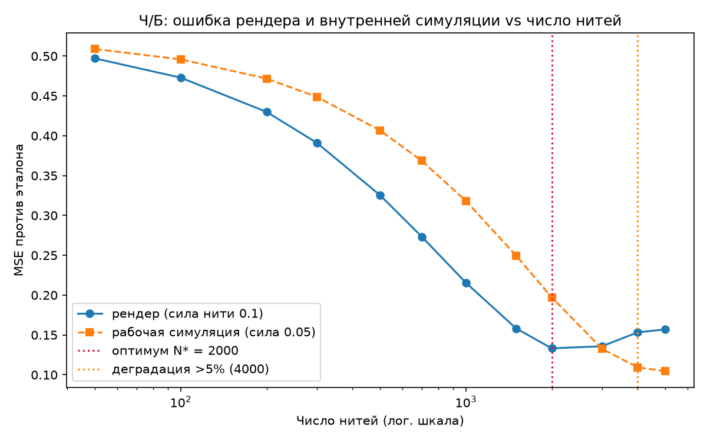
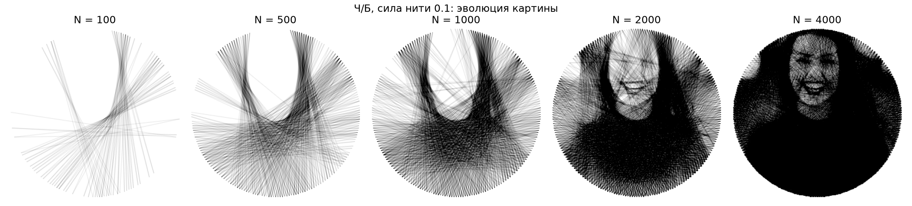
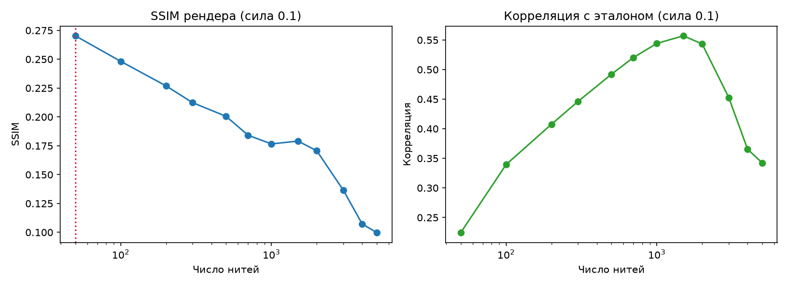
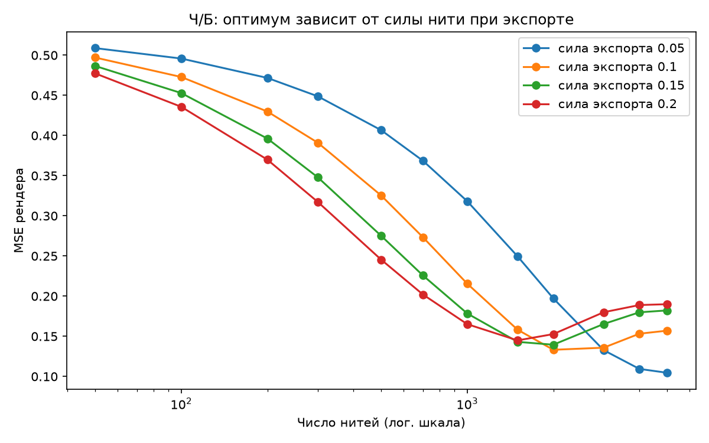
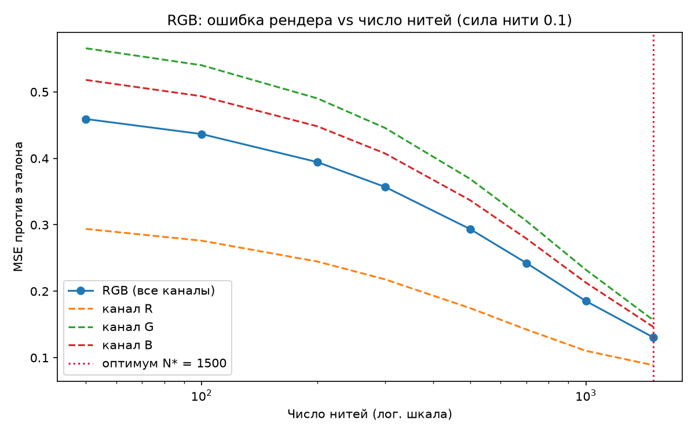

# Анализ качества от числа нитей

**Вопрос:** реальная thread-art картина требует **3000–7000** протяжек нити. Когда генерируемая
картина достигает идеального качества, а когда начинается деградация?

**Короткий ответ:** всё решает сила нити при экспорте (`-s`). С дефолтным `-s 0.1` оптимум
наступает уже на **~1500–2000** нитях, дальше картина перетемняется — диапазон 3000–7000
с дефолтом это пересборка. Чтобы честно использовать 3000–7000 нитей, нужен **`-s 0.05`**:
тогда ошибка монотонно падает вплоть до насыщения алгоритма (~3400–5700 улучшающих протяжек),
без всякой деградации.

## Метод

- Портреты из `tests/data/` (Unsplash), полный пайплайн как в CLI: квадратурный кроп →
  300×300, 211 гвоздь (`-n 4`, круг), жадный алгоритм до **7000 итераций**.
- Жадная последовательность **префикс-детерминирована**: первые N нитей прогона на 7000
  совпадают с прогоном на N. Поэтому один дорогой прогон + дешёвые рендеры префиксов дают
  все точки (50 → 7000 нитей, лог-шкала).
- Метрики на каждом срезе: MSE рендера против эталона, SSIM, корреляция, средняя яркость;
  плюс MSE **внутренней симуляции** — того холста, который алгоритм фактически оптимизирует.
- Воспроизведение: `uv run python scripts/quality_analysis.py --mode bw|rgb --photo <фото>`,
  данные: `docs/img/metrics_*.json`, ~2.5 мин на Ч/Б прогон.

## Главный результат: качество рендера и имитации расходятся

Женский портрет (`portrait_woman_1`), сила нити при экспорте **0.1** (дефолт CLI):

| Нитей | 50 | 500 | 1000 | 1500 | 2000 | 3000 | 4000 | 5000 |
|---|---|---|---|---|---|---|---|---|
| MSE рендера | 0.497 | 0.325 | 0.216 | 0.158 | **0.133** | 0.136 | 0.153 | 0.157 |
| MSE симуляции | 0.509 | 0.407 | 0.318 | 0.250 | 0.197 | 0.133 | 0.109 | **0.105** |

- **Симуляция** (нить силой 0.05) улучшается монотонно и не деградирует никогда —
  алгоритм принимает только улучшающие протяжки.
- **Рендер** (накопительное затемнение силой 0.1) выходит на оптимум при **N\* = 2000**,
  к 4000 нитям ошибка +15% к минимуму, к 5000 — +18%. Визуально: картина уплотняется и
  темнеет, света «забиваются».

Эволюцию видно на монтаже (N = 100 → 7000, `-s 0.1`): после ~2000 нитей прирост детализации
почти исчезает, затем появляется перетемнение:

Подтверждение на втором портрете (`portrait_man_1`): N\* = **1500** (MSE 0.0945),
к 2000 — уже +24%, к 3000 — +71%. Корреляция с эталоном на обоих портретах пикуется при
**N = 1500** и проседает на 5% после 2000–3000:

Замечание про SSIM: у thread-рендеров SSIM ведет себя контринтуитивно — максимум на
N = 50 и монотонный спад. Тонкие AA-линии ломают локальную статистику окна SSIM, поэтому
как абсолютная метрика «качества картины» он здесь непригоден; честные метрики — MSE
и корреляция.

## Механизм деградации: сила нити при экспорте ≠ рабочая сила

Алгоритм ищет нити на **внутреннем холсте**, где каждая протяжка меняет яркость линии с
эффективной силой **0.05** (Ч/Б). Экспортный рендер накапливает затемнение с силой **`-s`**
(дефолт 0.1, т.е. вдвое сильнее) на каждое пересечение пикселя нитью. Рендер «догоняет»
целевую яркость примерно на половине пути симуляции, а дальше систематически перетемняет.

Прямое следствие: **при `-s 0.05` рендер математически совпадает с симуляцией** (клип 0..1
монотонен) — кривые MSE ложатся друг на друга, оптимум сдвигается к самому насыщению,
деградации нет. Семейство кривых по `-s`:

| `-s` | N\* (woman_1) | деградация >5% | N\* (man_1) | деградация >5% |
|---|---|---|---|---|
| 0.05 | ≥5000 (нет) | нет | ≥3000 (нет) | нет |
| 0.1 (дефолт) | 2000 | 4000 | 1500 | 2000 |
| 0.15 | 2000 | 3000 | 1000 | 1500 |
| 0.2 | 1500 | 2000 | 700 | 1000 |

Эмпирическое правило: **N\*·s ≈ 150–300** — во сколько раз больше нити, во столько раз
меньше нужна сила.

## RGB: деградации нет, потому что силы совпадают

В RGB-конвейере рабочая сила и сила экспорта **обе 0.1** — рассогласования нет.
Канальные жадные прогоны насыщаются на **1836 (R) / 3152 (G) / 2866 (B)** улучшающих
протяжках из 7000 итераций; ошибка рендера монотонно падает во всём измеренном диапазоне
(до 1500 нитей, ограничено насыщением R-канала):

## Насыщение алгоритма

Жадный поиск сам сигнализирует предел: из 7000 итераций улучшающими оказались только
**5706** (woman_1) и **3400** (man_1) — до 51% итераций уже не находят улучшающей нити.
Гнаться за количеством итераций сверх насыщения бессмысленно: порядок нитей просто
обрывается.

## Практические рекомендации

| Целевое число нитей | Рекомендуемый `-s` (Ч/Б) | Комментарий |
|---|---|---|
| ~500–1500 | 0.15–0.2 | быстрые плотные картины |
| ~1500–2000 | 0.1 (дефолт) | оптимум дефолтных настроек |
| **3000–7000** | **0.05** | рендер = симуляция, деградации нет, качество до насыщения |
| ~7000+ | <0.05 (пропорционально) | но алгоритм насыщается на ~3400–5700 нитях |

Для RGB дефолт уже согласован — деградации нет, специальные настройки не нужны.
Порог остановки без `-l` (3 неулучшающие протяжки подряд) срабатывает корректно и
останавливает поиск у насыщения.

## Артефакты

- `scripts/quality_analysis.py` — воспроизводимость (детерминировано, ~2.5 мин Ч/Б)
- `docs/img/metrics_bw_portrait_{woman_1,man_1}.json`, `metrics_rgb_portrait_woman_1.json` — сырые метрики
- Фикстуры: `tests/data/` (Unsplash, Unsplash License)
