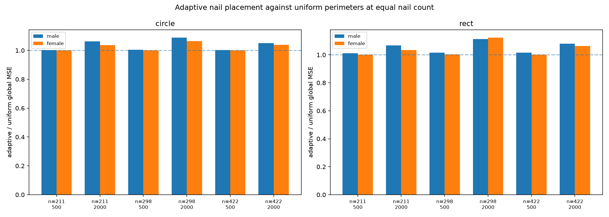

# Adaptive nail placement: gradient-scored against uniform perimeters

Question : a portrait's detail lives in the eyes and mouth while the forehead is flat. Does placing the same nail count where the Sobel gradient is dense beat uniform perimeters?

Answer: no, decisively. Adaptive placement loses to uniform on every tested combination: 24 facets across two fixtures, two layouts, three nail counts and two budgets. Global MSE never improves (best case +0.0 percent, worst case -12.4 percent) and center MSE degrades by 1.7 to 52.6 percent. The pre-registered bar (adopt on 3 percent global or 8 percent center gain on both fixtures) fails everywhere. No flag ships; the question closes.

## The algorithm

1. Sobel gradient magnitude of the working target (`_core.gradient_magnitude`, hand-verified on a 5 x 5 ramp: interior response 8, clamped edges 4).
2. Candidate pool: M = 4 x count positions evenly spaced on the perimeter (ellipse ring for circle, border walk for rect).
3. Score(s) = sum of gradient magnitude within a 40 px disc around the candidate.
4. Greedy selection of `count` candidates by descending score, every pick at least one candidate slot away from the previous picks, rounding duplicates skipped.

Prototype in `src/restring/adaptive.py` (stdlib only); experiment script `scripts/adaptive_nails_experiment.py`, raw data `docs/img/adaptive_nails_experiment.json`.

## Setup

Both portrait fixtures, circle and rect layouts, nail counts 211 / 298 / 422 (adaptive and uniform at exactly equal count), budgets 500 and 2000, working strength 0.05, export 600 px. Metrics: global render MSE, center MSE inside the central 50 percent box, search time (identical for both: cost depends on the count, not the positions).

## Results

Male fixture, global MSE adaptive/uniform (female within two points of every row):

| Count | Budget | Circle uniform | Circle adaptive | Rect uniform | Rect adaptive |
|---|---|---|---|---|---|
| 211 | 500 | 0.2242 | 0.2248 | see json | see json |
| 211 | 2000 | 0.1394 | 0.1480 | — | — |
| 298 | 2000 | 0.1388 | 0.1512 | 0.1073 | 0.1195 |
| 422 | 2000 | 0.1383 | 0.1453 | — | — |

Full tables: `docs/img/adaptive_nails_experiment.json`. Gain summary across all 24 facets: global MSE best +0.0 percent, worst -12.4 percent; center MSE best -1.7 percent, worst -52.6 percent. Adaptive is worse at equal nail count everywhere, and dramatically worse in the center box at 2000-pull budgets.

## The mechanism that failed

Two forces work against gradient concentration:

1. Nails do not paint where they sit. A pull is a chord between two perimeter nails, and the chord's ink lands along its whole length, including the interior. Detail in the eyes is reachable by chords between any two perimeter points that cross the eyes, and uniform spacing already supplies those chords. Moving both endpoints onto the busy edges does not aim chords at the eyes and only thins the nail coverage that feeds the flat regions, which then render under-inked.

2. Starved regions poison the search. With fewer nails near flat areas, chords that would have darkened those areas vanish from the candidate pool entirely; the search spends its budget on the dense edge instead, and the whole render degrades, visible as the large center-box losses at 2000 pulls, where the budget is long enough for the starvation to compound.

The survey's per-pixel error caps and Sobel boosts (isandrocks) work because they change which candidate pull wins during the scan. Placement happens before any pixel error exists, so it optimizes a proxy (gradient density) instead of the objective (render error).

## Verdict

Rejected. No `--adaptive` flag ships; the negative stands until someone proposes a placement objective that measures chord expressiveness rather than gradient density.

