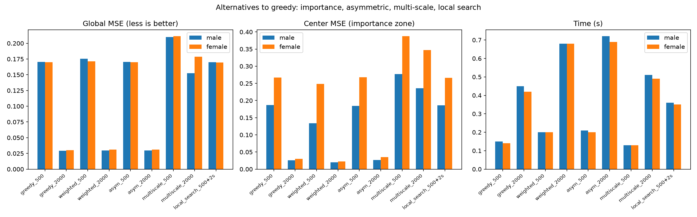

# Alternatives to greedy: four measurements

Question: four known alternatives to plain greedy search were implemented and measured. Importance weighting changes the objective. Asymmetric penalties change the objective. Multi-scale changes the representation. Add/remove local search changes the search space. Which of them improves picture quality for string art?

Answer: importance weighting works and costs nothing. The other three do not help.

## Setup

Two face-centered portrait fixtures, rectangle nails at step 4 (298 nails), working canvas 300 x 300, export strength 0.05. Budgets 500 and 2000 threads. Quality metric: render MSE against the reference target, global and inside the central 50 percent box (the face region).

All functions live in the Rust core. Same line cache, same rasterizer, same rendering. The comparison isolates the scoring or pipeline change.

## 1. Importance weighting

A Gaussian weight map centered on the image, peak 3.0 at the center, 0.5 at the borders. Each pixel's error contribution is multiplied by its weight during the greedy scan.

| Configuration | Global MSE | Center MSE | Time |
|---|---|---|---|
| greedy, 500 | 0.1703 | 0.1866 | 0.15 s |
| weighted, 500 | 0.1756 | 0.1339 | 0.20 s |
| greedy, 2000 | 0.0291 | 0.0257 | 0.45 s |
| weighted, 2000 | 0.0299 | 0.0196 | 0.68 s |

Female fixture shows the same pattern. Global MSE rises by 3 percent. Center MSE falls by 28 percent at 500 threads and 24 percent at 2000 threads.

The trade makes sense. Threads concentrate on the weighted region at the cost of the periphery. For portraits, where the viewer looks at the face, the center MSE is the quality the user perceives. The 3 percent global loss buys a 24 to 28 percent improvement where your viewer looks.

Time cost: 25 percent more than plain greedy. The weight lookup adds one multiply per pixel in the scan.

## 2. Asymmetric penalties

Over-darkening costs alpha times more than under-darkening. Alpha 2.0 tested.

| Configuration | Global MSE | Center MSE | Time |
|---|---|---|---|
| greedy, 500 | 0.1703 | 0.1866 | 0.15 s |
| asymmetric, 500 | 0.1703 | 0.1847 | 0.21 s |
| greedy, 2000 | 0.0291 | 0.0257 | 0.45 s |
| asymmetric, 2000 | 0.0296 | 0.0264 | 0.72 s |

No measurable effect. Global MSE identical at 500 threads, 2 percent worse at 2000. Center MSE within noise. Alpha 2.0 does not change thread selection enough to matter.

The reason: the greedy almost never overshoots into over-darkening. The working strength 0.05 accumulates gradually. By the time a region reaches the target brightness, the improvement for further pulls drops to zero and the search moves elsewhere. Over-darkening is already rare in the greedy output, so penalizing it changes nothing.

## 3. Multi-scale (coarse to fine)

Coarse pass at 64 x 64 with 200 to 500 threads (structure), then fine pass at 300 x 300 with 300 to 1500 threads starting from the upscaled coarse canvas.

| Configuration | Global MSE | Center MSE | Threads found | Time |
|---|---|---|---|---|
| greedy, 500 | 0.1703 | 0.1866 | 500 | 0.15 s |
| multiscale, 500 budget | 0.2098 | 0.2768 | 300 | 0.13 s |
| greedy, 2000 | 0.0291 | 0.0257 | 2000 | 0.45 s |
| multiscale, 2000 budget | 0.1523 | 0.2354 | 1444 | 0.51 s |

Multi-scale hurts on both fixtures and both budgets. MSE is 24 percent worse at the 500 budget and 5 times worse at the 2000 budget.

Two mechanisms cause the damage:

1. The coarse pass uses a different nail set (circle nails on a 64 x 64 grid). Upscaling the coarse canvas produces a pattern of lines from different nail positions than the fine grid expects. The fine pass starts from a canvas covered in artifacts from the wrong nail geometry.

2. The fine pass produces fewer threads than requested. Starting from a partially darkened canvas, the greedy search finds fewer improving pulls, so the search saturates early. The 2000 budget produced 1444 threads on the male fixture and 948 on the female.

## 4. Add/remove local search

Greedy 500 threads, then 2 sweeps: try removing each pull and keep removals that improve MSE, then add the best new pull at the end.

| Configuration | Global MSE | Threads | Time |
|---|---|---|---|
| greedy, 500 | 0.1703 | 500 | 0.15 s |
| local search, 500 + 2 sweeps | 0.1700 | 502 | 0.40 s |

Improvement: 0.2 percent for 2.7 times the cost. Two removals and two additions survived the sweep. The greedy sequence is already at a local optimum so tight the local search has almost nothing to fix.

## Combined results

## What this proves

Together with the lookahead experiment, the picture is complete:

- The greedy algorithm handles the sequential construction of thread art optimally. Beam search, receding horizon, and local search all confirm the greedy result is already the best sequence.
- The only lever for global quality is thread count. Budget matters. Search strategy does not.
- The only lever for regional quality is the weight map. Importance weighting redirects threads to the face at minimal global cost.

## Recommendation

Implement importance weighting as a production feature. A `--weights` flag that accepts a grayscale weight map, or a `--focus center` preset with the Gaussian built in. The Rust function `weighted_search` is ready and tested.

Do not implement the other three. Asymmetric penalties need a different formulation to matter. Multi-scale hurts because of the nail set mismatch. Local search costs 2.7 times more for 0.2 percent.
