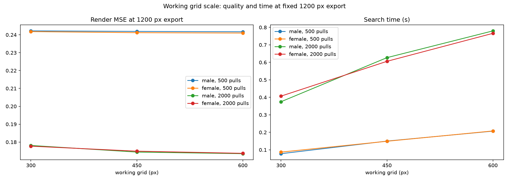

# Working grid scale: 300 against 450 and 600

Question: everything is tuned around a 300 x 300 working grid. Does searching above 300 pay, or is the compute better spent elsewhere?

Answer: keep 300. At the production working strength the gain from searching at 450 or 600 stays between 0.1 and 2.6 percent MSE, under the pre-registered 3 percent bar, at 1.5 to 2.4x the time. The flag does not ship and the 300 constant stands.

Verdict rules were pre-registered in tasks/05-working-grid-scale.md: keep 300 if the gain stays under 3 percent MSE or the time grows past 3x.

## Setup

Both portrait fixtures, rectangle nails with the nail count held at 300 (step 4 at grid 300, step 6 at 450, step 8 at 600), working grids 300, 450, 600, working strengths 0.05 and 0.1, budgets 500 and 2000 pulls. Every pull order renders at a fixed 1200 px export with strength 0.05, and quality is the render MSE and grayscale SSIM against the same 1200 px reference. Cache time comes from an immediate-break run (a scan of zero pulls measures the cache build); search time is the total minus the cache. The sweep lives in `scripts/grid_scale_experiment.py`, raw data in `docs/img/grid_scale_experiment.json`.

The strength sweep controls a confound: at 600 the canvas holds 4x the pixels, so the same per-pull ink darkens relatively less. A mistuned strength would masquerade as a grid effect.

## Results at the production strength 0.05

| Grid | Male MSE, 500 | Male MSE, 2000 | Female MSE, 500 | Female MSE, 2000 | Time, 2000 (cache + search) |
|---|---|---|---|---|---|
| 300 | 0.2422 | 0.1781 | 0.2418 | 0.1777 | 0.06 + 0.37 s |
| 450 | 0.2419 | 0.1744 | 0.2412 | 0.1749 | 0.10 + 0.63 s |
| 600 | 0.2417 | 0.1735 | 0.2410 | 0.1737 | 0.09 + 0.78 s |

The 2000-pull gains are +2.1 to +2.6 percent at grid 450 and 600; the 500-pull gains are 0.1 to 0.3 percent. SSIM moves the same way (male: 0.309 to 0.353 at 2000). Every gain misses the 3 percent bar; the time multiplier reaches 1.5x at 450 and 2.0 to 2.4x at 600, inside the 3x limit but pointless at these returns.

Two effects cancel out. Finer working detail helps the search pick better chords, and the fixed 1200 px export stretches any working pattern regardless of grid, washing out most of the difference.

## The strength interaction explains most of the folklore

At working strength 0.1 the picture flips: 2000-pull MSE improves 15 to 16 percent from grid 300 to 600 (male 0.2098 to 0.1777, female 0.2111 to 0.1774). The mechanism is saturation, not detail. At 0.1 and grid 300 the channels saturate before the budget: the scan stops finding improving pulls, so the effective thread count collapses. At grid 600 the same ink spreads over 4x the pixels, saturation arrives later, and the budget gets spent. The grid looks like the hero; the mistuned strength is the actual problem.

The production pipeline runs B/W at 0.05 and RGB at 0.05 since the RGB sweep (see [rgb-channels-experiment.md](rgb-channels-experiment.md)), so this interaction does not apply to shipped defaults.

## Verdict

Keep 300. The working grid above 300 buys under 3 percent MSE at up to 2.4x the time, and the visible wins attributed to larger grids reproduce a strength misconfiguration instead. `LONG_SIDE = 300` stays, no `-g` flag ships.

## Recommendation

Keep `LONG_SIDE = 300` and keep steering users to strength 0.05 for large budgets. If a future physical preset needs finer detail, the lever with measured returns is thread count at a fixed grid, not a bigger grid.
