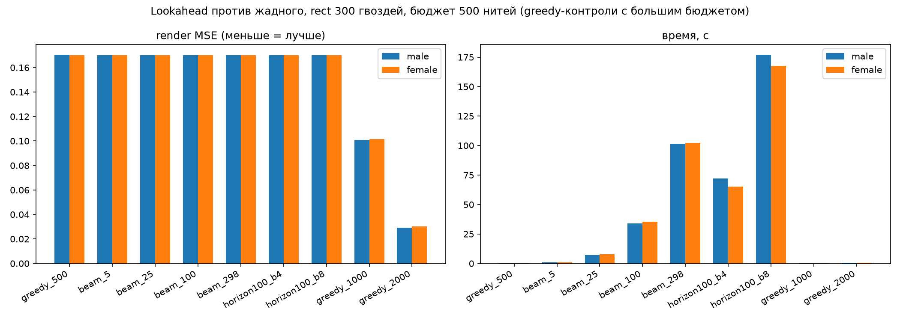

# Lookahead experiment: why beam search and receding horizon fail on string art

Question: does looking ahead improve picture quality? The greedy search commits the best pull at each step. A smarter search would evaluate several future steps before committing. Beam search and receding-horizon search are the two standard approaches. Both were implemented in the Rust core and measured against the greedy baseline.

Answer: no. Every lookahead variant produced the same MSE as greedy at the same thread budget. The greedy search is structurally optimal for this problem. Time spent on lookahead buys zero quality. Time spent on more threads buys a lot.

## Setup

Two face-centered portrait fixtures, rectangle nails at step 4 (298 nails), working canvas 300 x 300, thread budget 500 pulls, export strength 0.05. Quality metric: render MSE against the reference target.

Three search strategies:

- Greedy: pick the pull with the highest immediate improvement. Current production algorithm.
- Beam search of width W: keep W partial pull sequences alive. At each step, expand every alive sequence with every candidate pull, then keep the W best by cumulative improvement. Width 1 equals greedy bit for bit. Width 298 equals an exhaustive two-step search.
- Receding horizon (MPC, rollout style): for every committed pull, roll a beam of W hypotheses 100 steps into the future, then commit only the first pull of the best final hypothesis. The horizon slides forward by one.

Beam width 1 reproduces the greedy pull order exactly, verified against the golden test fixture. All three searches share the same line cache, rasterizer and improvement scoring, so the comparison isolates the search strategy.

## Results

| Configuration | Time, male | MSE, male | MSE, female |
|---|---|---|---|
| greedy, 500 threads | 0.2 s | 0.1702 | 0.1701 |
| beam width 5 | 1.0 s | 0.1702 | 0.1700 |
| beam width 25 | 7.0 s | 0.1702 | 0.1700 |
| beam width 100 | 34.1 s | 0.1702 | 0.1700 |
| beam width 298, exhaustive 2-step | 101.4 s | 0.1702 | 0.1700 |
| horizon 100 steps, beam 4 | 72.1 s | 0.1702 | 0.1700 |
| horizon 100 steps, beam 8 | 176.9 s | 0.1702 | 0.1700 |

Controls with more threads instead of smarter search:

| Configuration | Time, male | MSE, male | MSE, female |
|---|---|---|---|
| greedy, 1000 threads | 0.2 s | 0.1009 | 0.1015 |
| greedy, 2000 threads | 0.4 s | 0.0291 | 0.0303 |

## Why lookahead fails here

Pull improvements are almost independent. Each thread changes about 150 pixels on a 90,000-pixel canvas. Two random chords overlap in zero to five pixels. Pulling thread A first barely changes the score of pulling thread B second. When step scores do not interact, the greedy choice at each step is already near the global optimum for the sequence.

Beam search confirms this. Width 5, 25, 100 and 298 all reach MSE 0.1702. An exhaustive two-step search (width 298) explores 298 candidate futures at every step and still lands on the same sequence. No alternative path exists.

The 100-step horizon search confirms the same from the other direction. Rolling 100 steps forward with beam 4 or 8 costs 72 to 177 seconds and produces the identical MSE. The first pull of the best 100-step hypothesis matches the greedy pull because the future score barely depends on the first choice.

## The honest comparison

greedy with 2000 threads takes 0.4 seconds and reaches MSE 0.0291. The best lookahead variant takes 101 seconds and reaches MSE 0.1702 at 500 threads. More threads win by 6 times on quality at 250 times less cost.

## What this proves about the algorithm

The greedy search is not a compromise. For a problem where pull improvements are nearly independent, greedy is the right algorithm. The related-work survey lists every serious project using greedy or a close variant. None reports a lookahead improvement. Now you have the measurement confirming why.

## Status of the code

The beam and horizon functions live in `restring._core` as experimental code. The production pipeline does not call them. The `create_art` function is unchanged. The experiment script is `scripts/beam_experiment.py`. Raw data is in `docs/img/beam_experiment.json`.
