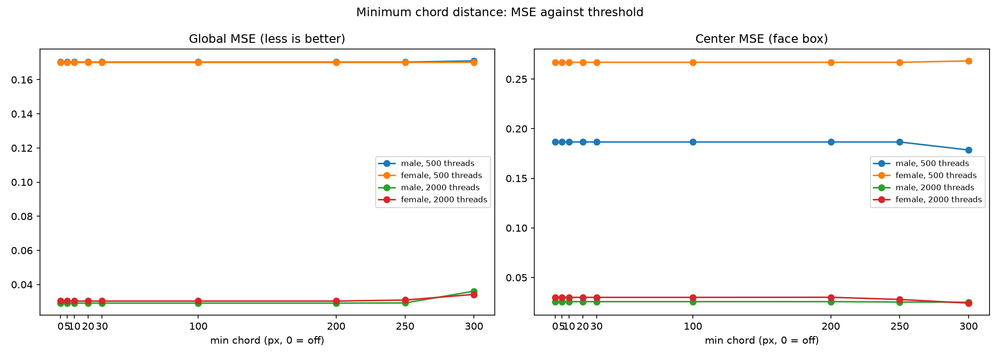

# Minimum chord distance: nine measurements

Question: the canonical kaspermeerts gist runs every pull through a `MIN_DISTANCE=20` filter on 288 pins, and most descendant projects keep a version of it. Does banning short chords improve quality here?

Answer: no. The greedy search on portrait targets never picks short chords in the first place. Thresholds in the recommended 5 to 30 px range leave the pull order byte-identical to the unfiltered run. Filters only start to bite past the natural minimum chord, near 250 px, and past that point global MSE degrades by up to 24 percent. The flag ships with default off.

## Setup

Two face-centered portrait fixtures, rectangle nails at step 4 (300 nails), working canvas 300 x 300, export strength 0.05. Budgets 500 and 2000 threads. Thresholds 0 (off), 5, 10, 20, 30, 100, 200, 250, 300 px. Quality metric: render MSE against the reference target, global and inside the central 50 percent box (the face region), plus the average chord length of the pull order.

## The chord distribution comes first

The unfiltered greedy run already avoids short chords by construction. Consecutive pull distances on the 2000-thread budget:

| Fixture | Minimum chord | Median chord | Average chord |
|---|---|---|---|
| male | 229.5 px | 309.5 px | 323.1 px |
| female | 148.0 px | 309.5 px | 316.2 px |

The reason sits in the scoring. A pull's improvement is the summed squared-error drop over every pixel of the chord. A 300 px chord crosses the canvas and touches hundreds of pixels. A 5 px chord touches five. Unless the canvas is fully saturated, the long chord wins the scan. Short pulls appear only when long chords stop improving. By then the search has nothing left to pull anyway.

So the suggested starting values 5, 10, 20 and 30 px sit three to seven times below the natural minimum. They never fire.

## Threshold sweep, 2000 threads

| Threshold | Male global MSE | Male center MSE | Female global MSE | Female center MSE |
|---|---|---|---|---|
| off | 0.0291 | 0.0257 | 0.0303 | 0.0300 |
| 5 px | 0.0291 | 0.0257 | 0.0303 | 0.0300 |
| 10 px | 0.0291 | 0.0257 | 0.0303 | 0.0300 |
| 20 px | 0.0291 | 0.0257 | 0.0303 | 0.0300 |
| 30 px | 0.0291 | 0.0257 | 0.0303 | 0.0300 |
| 100 px | 0.0291 | 0.0257 | 0.0303 | 0.0300 |
| 200 px | 0.0291 | 0.0257 | 0.0303 | 0.0301 |
| 250 px | 0.0292 | 0.0253 | 0.0309 | 0.0279 |
| 300 px | 0.0361 | 0.0251 | 0.0342 | 0.0242 |

The 500-thread budget shows the same shape: identical rows up to 250 px, then degradation.

The first change appears at 200 px on the female fixture (natural minimum 148 px): a handful of pulls get replaced, global MSE stays flat. At 250 px the filter starts removing chords the search wants and global MSE rises 0.3 to 2 percent. At 300 px the damage is clear: global MSE up 24 percent on the male fixture and 13 percent on the female. Center MSE improves slightly at 300 px (0.0300 to 0.0242 on the female fixture) because the forced detours happen to concentrate ink on the face, but the global cost dwarfs the local gain.

## Dead-end recovery

The filter needs an escape hatch: when every chord from the current nail sits below the threshold, the search would stall. The core takes the best masked-out pull for one iteration and logs once at DEBUG. On both fixtures, at both budgets and every threshold in the sweep, this path never triggered. The layouts are dense enough for allowed candidates to always exist.

## Adoption check

The pre-registered rule in the task file: adopt a default only if a threshold improves global MSE by 3 percent or more at an equal budget. Measured best case: 0.0 percent. Verdict: no default. The `--min-chord` flag ships with default off for custom layouts and future experiments.

## What this proves

- The greedy scoring already implements the intent of `MIN_DISTANCE` better than a filter: long chords dominate short ones unless they genuinely lose.
- Short-pull clutter is not a problem on portrait targets in this pipeline. Thread economy is bounded by the search stopping at saturation, not by wasteful short pulls.
- A chord filter on this code base only becomes active at thresholds around 250 px and above, where the constraint works as a long-chord penalty and degrades quality.

## Recommendation

Keep the flag off by default. Do not add a `MIN_LOOP`-style recent-nail memory. The greedy already avoids revisiting the neighborhood, so the memory has nothing to fix. Revisit only for sparse custom layouts (T-13) where dead ends become common.
