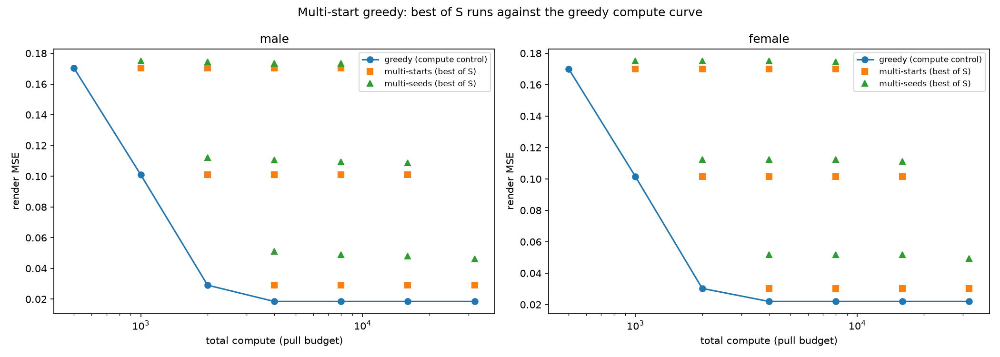

# Multi-start greedy: the last search-strategy measurement

Question (pre-registered in tasks/17-multistart-research.md): multi-start — run the greedy from several starting states, keep the best run — is the only untested member of the search-strategy family. Does the best of S runs at budget B beat a single greedy run at the same total compute B x S?

Answer: no, by the widest margin of the whole family. On both fixtures, every S in 2/4/8/16, both start axes (starting nail, subset seed) and all three budgets, the best multi-start run loses to the greedy compute control. The gain is at best exactly zero: starting-nail rotations produce bit-identical pull orders to the plain run, so multi-start by start diversity delivers precisely the single-run result while spending S times the compute. The verdict closes the family: no known search modification beats spending the same compute on more threads.

## Setup

Both portrait fixtures, rectangle nails at step 4, working grid 300, budgets B in 500 / 1000 / 2000. Variations:

- Starting nails: rotate the nail list by i x N / S for S runs (starts evenly spread over the ring), budget B each, keep the run with the lowest final canvas error.
- Subset seeds: `-r 100` with seeds 42, 43, ... (one run per seed, S runs, best kept). The `seed` parameter is new in the core (`create_art(..., seed=None)`, default 42, goldens untouched).
- Controls: greedy at B and at every B x S, equal total compute.

Metrics: render MSE at the 300 px export against the gray reference, wall time. Script: `scripts/multistart_experiment.py`, raw data `docs/img/multistart_experiment.json`.

## Results (male fixture; female identical in shape)

| Configuration | Total compute | MSE | Time |
|---|---|---|---|
| greedy 500 | 500 | 0.1703 | 0.15 s |
| greedy 1000 | 1000 | 0.1009 | 0.24 s |
| greedy 2000 | 2000 | 0.0291 | 0.45 s |
| greedy 4000 / 8000 / 16000 / 32000 | 4000+ | 0.0185 | 0.83 to 5.84 s |
| best of 16 starts, B 500 | 8000 | 0.1703 | 2.5 s |
| best of 16 seeds, B 500 | 8000 | 0.1735 | 1.9 s |
| best of 16 starts, B 2000 | 32000 | 0.0291 | 8 s |
| best of 16 seeds, B 2000 | 32000 | 0.0494 | 7 s |

Every multi-start configuration loses to the matched-compute greedy control, most by hundreds of percent. Gain summary across all 48 comparisons: best case +0.0 percent (start diversity at B 2000, where multi-start equals the single run), worst -838 percent (seed diversity at B 500 against the saturated control).

## Mechanism: start diversity is a no-op, seed diversity is a loss

Two distinct findings hide in the verdict:

1. Starting-nail rotations produce pull orders with identical final MSE to four decimals — the greedy is start-invariant here. The first chord from any nail on the ring is the same canvas-crossing dark-region chord up to which endpoints it touches, and after a handful of pulls every run sits in the same high-improvement regime. The candidate space from every perimeter point is the same dense all-pairs line cache, so "where you start" selects among chords that all exist in every other run's future anyway. Best-of-S by rotation spends S times the compute to return the single-run result.

2. Subset-seed diversity is a loss multiplied. One `-r 100` run already gives up 2 to 4 percent MSE to the full scan; best-of-S recovers a sliver (0.1752 to 0.1735 at B 500 for S 2 to 16) but never reaches the full scan, let alone the deeper control. Diversity over subsampling trades a real quality loss for a random redraw, and the redraws correlate: every seed stars the same 100-of-298 information diet.

Against the saturated control the gap explodes because the greedy control converts extra compute into more threads until stagnation (0.0291 to 0.0185), while multi-start splits the same compute into runs that each stop far earlier.

## Family closure

| Strategy | Change | Verdict | Evidence |
|---|---|---|---|
| Beam search | wider search | no gain | docs/research/lookahead-experiment.md |
| Receding horizon (MPC) | deeper search | no gain | docs/research/lookahead-experiment.md |
| Multi-scale | coarse-to-fine representation | up to 5x worse | docs/research/alternatives-experiment.md |
| Asymmetric penalty | changed objective | no effect | docs/research/alternatives-experiment.md |
| Add/remove local search | changed search space | no gain | docs/research/alternatives-experiment.md |
| Multi-start | multiple starting states | no gain, worse at matched compute | this document |

No known search modification beats spending the same compute on more threads. The greedy's advantage is structural: the all-pairs line cache gives every step full candidate coverage, so the sequential greedy is already extracting everything the representation offers, and diversity of any kind re-spends compute on worse-informed runs.

## Recommendation

Nothing ships. The `seed` parameter stays in the core (useful for reproducibility experiments; default 42 keeps every golden and every published number bit-identical). This document closes the search-strategy family with six measured negatives.

