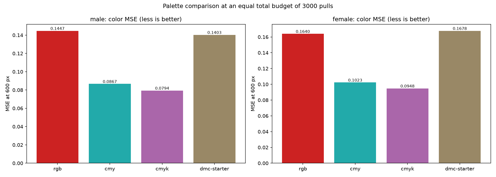

# Thread palettes: rgb against cmy, cmyk and DMC

Question: the RGB mode paints pure red, green and blue threads no shop sells. Which palette set produces better color string art at an equal total pull budget — the current RGB triple, subtractive CMY, CMYK with a black key thread, or a 20-color DMC floss starter set?

Answer: CMYK wins. At an equal budget of 3000 total pulls it improves color MSE by 42 to 45 percent over RGB on both fixtures, CMY improves it by 37 to 40 percent, and both pass the pre-registered 5 percent bar for a recommended palette. The 20-thread DMC starter fails the bar: at 150 pulls per thread each thread starves.

Verdict rules were pre-registered in tasks/12-thread-palette-system.md: a palette ships as recommended only on a 5 percent or better color MSE improvement over rgb at an equal budget, on both fixtures.

## Setup

Both portrait fixtures, rectangle nails at step 4, working grid 300, working strength 0.05, export 600 px. Total budget 3000 pulls split evenly across threads: rgb 3 x 1000, cmy 3 x 1000, cmyk 4 x 750, dmc-starter 20 x 150. Metric: color MSE of the render against the reference, plus per-thread pull counts and search time. Separation: each thread's gray target is the channel-weighted mean of the target pixels with weights from the thread color (for rgb this reduces to the plain channel split). Script: `scripts/palette_experiment.py`, raw data `docs/img/palette_experiment.json`.

## Results

| Palette | K | Male MSE | Female MSE | Change vs rgb |
|---|---|---|---|---|
| rgb (baseline) | 3 | 0.1447 | 0.1640 | — |
| cmy | 3 | 0.0867 | 0.1023 | +37.6 to +40.1 percent |
| cmyk | 4 | 0.0794 | 0.0948 | +42.2 to +45.1 percent |
| dmc-starter | 20 | 0.1403 | 0.1678 | +3.0 / -2.3 percent (fails) |

Search time stays flat across palette size at equal total budget (0.8 to 1.7 s): the cost scales with total pulls, not with K.

## Why CMY and CMYK dominate

The additive-on-white render darkens exactly the channels a thread carries. Pure red, green and blue threads each darken two channels and share the labor redundantly: the red and blue threads both push the same channels on half the color space, and no thread darkens all three at once, so neutral (gray) tones need all three threads fighting each other. Cyan, magenta and yellow are complementary: each carries a distinct channel pair, their targets partition the color space cleanly, and the black key thread in cmyk takes the neutral tones the primaries handle poorly. A real portrait is mostly neutrals and skin, which is exactly where the black key thread pays off.

## The DMC starter at this budget

Twenty threads at 150 pulls each produce per-thread coverage too thin to build structure; the palette loses to rgb on the female fixture. The 20-color set is not a dead end — it is starved. Its natural regime is a much larger total budget (6000 pulls means 300 per thread) or a smaller palette subset. Picking the best subset of a floss chart for a given photo is the follow-up this data motivates; the cap of 8 threads in the CLI keeps that choice explicit.

## Recommendation

Shipped as recommended: `--palette cmyk` for color runs (and `--palette cmy` when only three thread colors are available). `--palette rgb` stays for compatibility. The DMC starter file ships as data with the measured caveat: give each thread a real budget.

