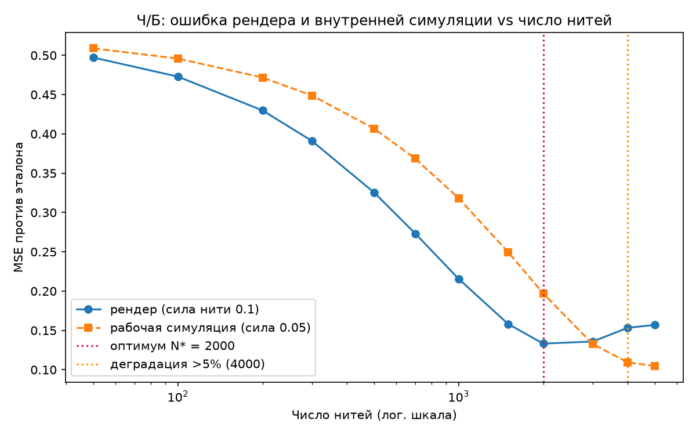
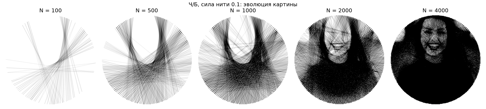
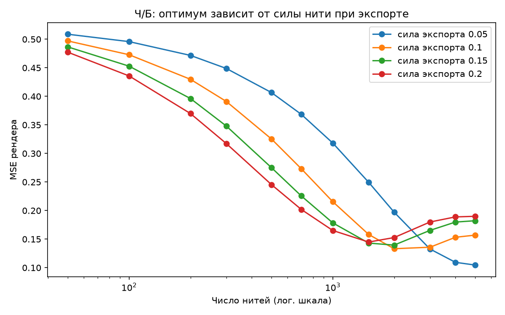
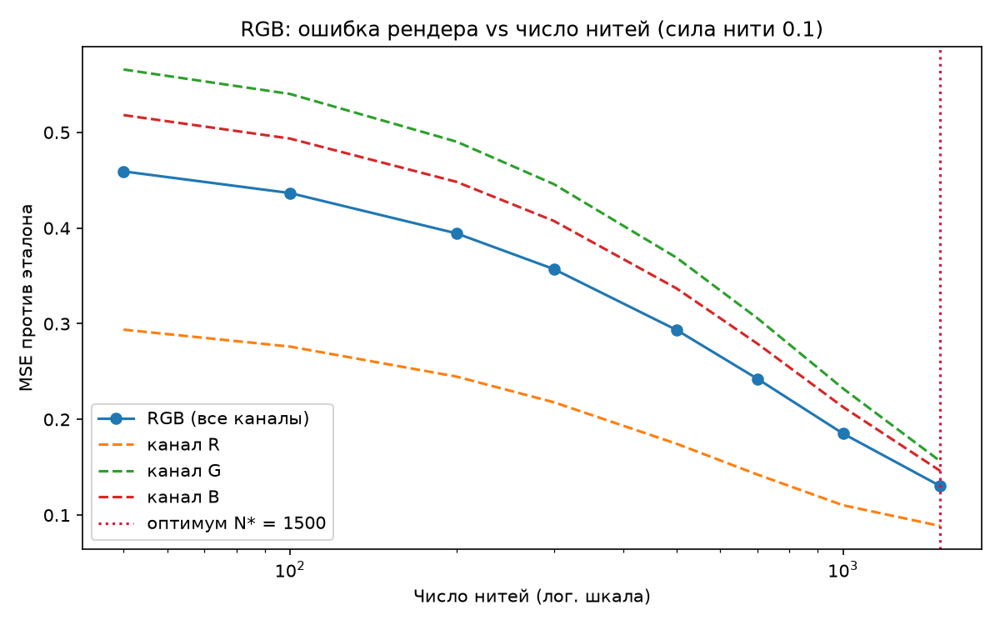

# Pull count against quality

> Status: historical experiment on the first fixtures, waist-up Unsplash portraits, before the Rust migration. The core findings, the export-strength mismatch and the `-s 0.05` rule for 3000 to 7000 threads, were reconfirmed on face-centered fixtures and the Rust core in [tuning.md](../tuning.md). Absolute numbers below belong to the original fixtures and were not re-measured.

Question: physical thread art needs 3000 to 7000 pulls. When does the generated picture reach its best quality, and when does quality start to degrade?

Short answer: export strength decides. With the default `-s 0.1` the optimum arrives near 1500 to 2000 threads and the picture darkens past the reference after. The 3000 to 7000 range with the default is an over-pull. Use `-s 0.05` for the full range: error falls monotonically until the search saturates near 3400 to 5700 improving pulls, with no degradation.

## Method

- Portraits from `tests/data/`, full CLI pipeline: square crop to 300 x 300, 211 nails at `-n 4`, circle, greedy search up to 7000 iterations.
- The greedy sequence is prefix-deterministic, so one long run per photo plus cheap prefix renders covers every sample point from 50 to 7000 threads.
- Metrics per sample: render MSE against the reference, SSIM, correlation, mean brightness, plus the MSE of the internal working simulation.
- Reproduce with `uv run python scripts/quality_analysis.py --mode bw --photo <path>`. Data in `docs/img/metrics_*.json`.

## Main result: render and simulation diverge

Female portrait, export strength 0.1:

| Threads | 50 | 500 | 1000 | 1500 | 2000 | 3000 | 4000 | 5000 |
|---|---|---|---|---|---|---|---|---|
| render MSE | 0.497 | 0.325 | 0.216 | 0.158 | 0.133 | 0.136 | 0.153 | 0.157 |
| simulation MSE | 0.509 | 0.407 | 0.318 | 0.250 | 0.197 | 0.133 | 0.109 | 0.105 |

The simulation improves monotonically and never degrades, because the search accepts only improving pulls. The render accumulates darkness at double the working strength, bottoms out at 2000 threads and rises 15 to 18 percent by 5000.

The second portrait confirms the pattern: optimum at 1500 threads, 24 percent worse at 2000, 71 percent worse at 3000. Correlation peaks at 1500 on both portraits.

One measurement caveat: SSIM misbehaves on thread renders. The windowed statistic peaks at 50 threads and falls monotonically after, because thin anti-aliased lines break the local statistics the metric assumes. MSE and correlation track perceived quality honestly here.

## Why degradation happens

The search scores pulls on a working canvas where each pull shifts line brightness by 0.05. The export accumulates each crossing at strength `-s`, and the default 0.1 doubles the working rate. The render reaches the target brightness around halfway and overshoots.

The consequence is exact: at `-s 0.05` the render equals the simulation, the two MSE curves lie on top of each other, the optimum moves to the saturation point and degradation disappears.

| `-s` | optimum, woman | degradation | optimum, man | degradation |
|---|---|---|---|---|
| 0.05 | 5000+, none | none | 3000+, none | none |
| 0.1, default | 2000 | 4000 | 1500 | 2000 |
| 0.15 | 2000 | 3000 | 1000 | 1500 |
| 0.2 | 1500 | 2000 | 700 | 1000 |

Rule of thumb: N\* times s stays near 150 to 300.

## RGB shows no degradation

The RGB pipeline uses 0.1 for both the working canvas and the export, so the mismatch does not exist. Channels saturate at 1836, 3152 and 2866 improving pulls out of 7000 iterations, and render error falls monotonically across the measured range.

## Saturation

Out of 7000 iterations the search found 5706 and 3400 improving pulls on the two portraits. Up to 51 percent of iterations found no improving pull. Budgets above saturation add nothing.
