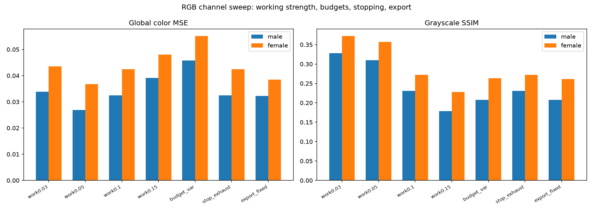

# RGB per-channel sweeps: four measurements

Question: the RGB pipeline runs one greedy search per channel on a shared nail grid, and four of its choices were never measured. All channels share working strength 0.1, budgets are equal, channels stop at the budget, and short channels get padded by repeating their last nail. Which of these choices are right?

Answer: one change is worth adopting. Halving the working strength from 0.1 to 0.05 improves global color MSE by 13 to 17 percent on both fixtures and raises grayscale SSIM by a quarter. The other three measurements are negative: variance-proportional budgets hurt badly, exhaustion stopping changes nothing, and the fixed 0.1 export loses to auto. The 0.05 working strength shipped; everything else stands.

Verdict rules were pre-registered in tasks/04-rgb-channel-sweeps.md: adopt only on 5 percent or better global color MSE improvement on both fixtures.

## Setup

Both portrait fixtures, rectangle nails at step 4 (300 nails), working canvas 300 x 300, budgets 2000 per channel, auto export strength (104/L clamped 0.03..0.2, `scripts/fit_export_strength.py`). Reference: the RGB target itself. Metrics: global color MSE, per-channel MSE, grayscale SSIM of the render against the gray target, share of padded pulls.

The sweep lives in `scripts/rgb_channel_sweep.py`; every number below comes from `docs/img/rgb_channel_sweep.json`.

## 1. Working strength per channel

The baseline 0.1 is double the B/W working strength (0.05). Swept 0.03, 0.05, 0.1, 0.15 with equal budgets and budgeted stopping:

| Working strength | Male global MSE | Female global MSE | Male SSIM | Female SSIM |
|---|---|---|---|---|
| 0.03 | 0.0339 | 0.0435 | 0.328 | 0.372 |
| 0.05 | 0.0269 | 0.0368 | 0.309 | 0.357 |
| 0.1 (old default) | 0.0325 | 0.0424 | 0.231 | 0.272 |
| 0.15 | 0.0391 | 0.0480 | 0.179 | 0.228 |

The curve bottoms at 0.05 on both fixtures: 17.2 percent better than the old default on the male fixture and 13.2 percent on the female. SSIM rises from 0.231 to 0.309 and from 0.272 to 0.357. The mechanism matches the B/W findings: per-pull ink scales with the working strength, and 0.1 saturates channel canvases before the budget runs out (pull counts 629 to 1336 at 0.1 against 2000 requested), wasting part of every budget.

At 0.05 the channels no longer saturate inside 2000 pulls (1997 to 2000 pulls spent), so the budget becomes the binding constraint and the render accumulates ink evenly.

Adopted: `generate_rgb` now runs channels at 0.05, matching B/W.

## 2. Budget split: equal vs proportional to channel variance

Splitting a fixed total budget across channels by their grayscale variance share instead of equally, at working strength 0.1:

| Configuration | Male global MSE | Female global MSE |
|---|---|---|
| equal 2000 + 2000 + 2000 | 0.0325 | 0.0424 |
| variance split (male 2087/1968/1745, female 1931/2509/3159) | 0.0458 | 0.0551 |

Variance-proportional budgets lose 31 to 41 percent. Variance measures spread, not ink demand: a high-variance channel is not a channel that needs more pulls. Rejected.

## 3. Stopping: budget vs exhaustion

Running every channel to exhaustion (3 consecutive non-improving scans) instead of the 2000 budget, at working strength 0.1: pull counts and MSE land identical to the budgeted run on both fixtures. At 0.1 every channel saturates before 2000 pulls anyway. The padded share reaches 3 to 18 percent of pulls with zero MSE cost: a padded channel repeats its last nail, which paints the same chord onto an already-saturated canvas and moves nothing. Rejected: the budget is not a foot-gun here.

## 4. Export strength: fixed 0.1 vs auto

Same orders, fixed 0.1 export against the auto 104/L law:

| Configuration | Male global MSE | Female global MSE |
|---|---|---|
| auto (baseline) | 0.0325 | 0.0424 |
| fixed 0.1 | 0.0322 | 0.0385 |

Fixed 0.1 wins by 0.9 percent on the male fixture and loses by 9.2 percent on the female. The mixed result fails the both-fixtures rule, and the auto law already ships as the default (T-03). Auto stands.

## What this proves

- The RGB pipeline's working strength was the real defect: 0.1 saturated channels early and wasted budget. 0.05 ships.
- Equal budgets are right. Channel variance does not predict ink demand.
- Padding is harmless. Repeated final chords cost nothing on a saturated canvas, so budgeted stopping needs no exhaustion logic.

## Recommendation

Shipped: working strength 0.05 for the RGB pipeline (goldens: `tests/test_rust_core.py::test_rgb_orders_golden`). Standing: equal budgets, budgeted stopping, auto per-channel export. Per-channel working strengths (one value per channel) were not tested and remain open for the palette work in T-12.
