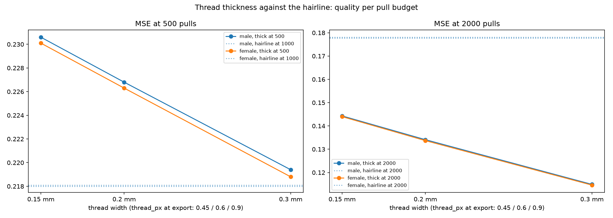

# Thread thickness against the hairline

Question (pre-registered in tasks/11-thread-thickness-render.md): at what thread width does the thick-render MSE at N pulls match the hairline MSE at 2N pulls? In other words, how much thread budget does a realistic thread width buy?

Answer: 0.3 mm on a 400 mm board (0.9 px at the 1200 px export) matches the hairline's double budget at N = 500, and at N = 2000 every tested width beats the hairline, the widest by 35 percent. Above the working grid, the hairline is an over-inked 1 px line; a thinner-than-1-px physical thread deposits a fraction of that ink and lands closer to the reference.

## Setup

Both portrait fixtures, rectangle nails at step 4 (300 nails), working grid 300, one 2000-pull search per fixture (greedy prefixes are budget-stable). Every render exports at a fixed 1200 px. Hairline: the classic 1-px renderer at N and 2N pulls (2N clamps to the search's saturation). Thick: the physical renderer at 0.15 / 0.2 / 0.3 mm on a 400 mm board, which is 0.45 / 0.6 / 0.9 px at the export. Working strength 0.05, export strength 0.05. Script: `scripts/thread_model_experiment.py`, raw data `docs/img/thread_model_experiment.json`.

## Results

Male fixture (female within 0.2 percent on every row):

| Render | Pulls | Thread width | MSE at 1200 px |
|---|---|---|---|
| hairline | 500 | 1 px | 0.2422 |
| thick | 500 | 0.15 mm (0.45 px) | 0.2306 |
| thick | 500 | 0.2 mm (0.60 px) | 0.2268 |
| thick | 500 | 0.3 mm (0.90 px) | 0.2194 |
| hairline | 1000 (= 2N) | 1 px | 0.2181 |
| hairline | 2000 | 1 px | 0.1781 |
| thick | 2000 | 0.15 mm (0.45 px) | 0.1443 |
| thick | 2000 | 0.2 mm (0.60 px) | 0.1341 |
| thick | 2000 | 0.3 mm (0.90 px) | 0.1149 |

Match points for the pre-registered question:

- N = 500: the hairline's double budget (1000 pulls, MSE 0.2181) is matched by a 0.3 mm thread at 500 pulls (0.2194, within 0.6 percent). Thickness buys a doubling of the pull budget.
- N = 2000: 2N = 4000 exceeds the search's saturation, so the reference is the hairline at 2000. Every tested width beats it, monotonically in width: 0.3 mm wins by 35 percent. No crossover inside the tested range.

## Why thickness helps here

At a 1200 px export the classic hairline stamps every touched pixel at full coverage: 1 px of ink per pixel of line. A physical thread below 1 px stamps fractional coverage, proportionally less ink per pixel. The same pull order reads as less over-darkened, and MSE against the reference falls. The effect grows with the export-to-working-grid ratio, consistent with the export-resolution finding in the tuning guide: exporting above the 300 px working grid hurts precisely because the hairline over-inks.

This also means `--realistic` at sub-pixel widths does more than look different: at 0.9 px it doubles as an ink-proportional large-export renderer.

## Recommendation

- Use `--realistic --thread-width 0.2` (or 0.3) whenever exporting well above the 300 px working grid; the render gets closer to the reference and to the physical board at the same time.
- At the default 300 px export, thread_px sits at or below 0.1 for typical boards and the physical model degenerates toward the hairline; the log states the computed width.
- Thickness does not change the search: pull orders stay golden-identical, only the render changes.

