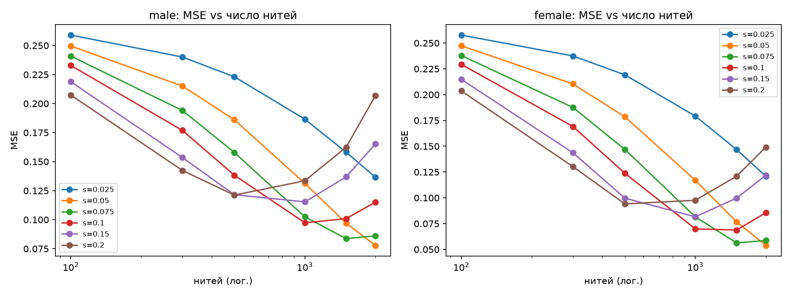
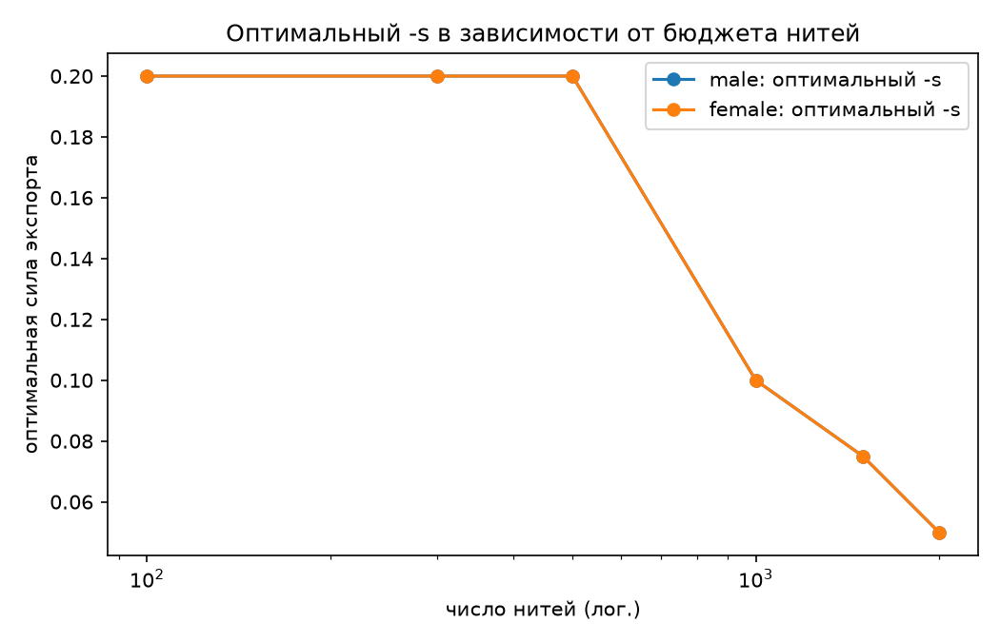
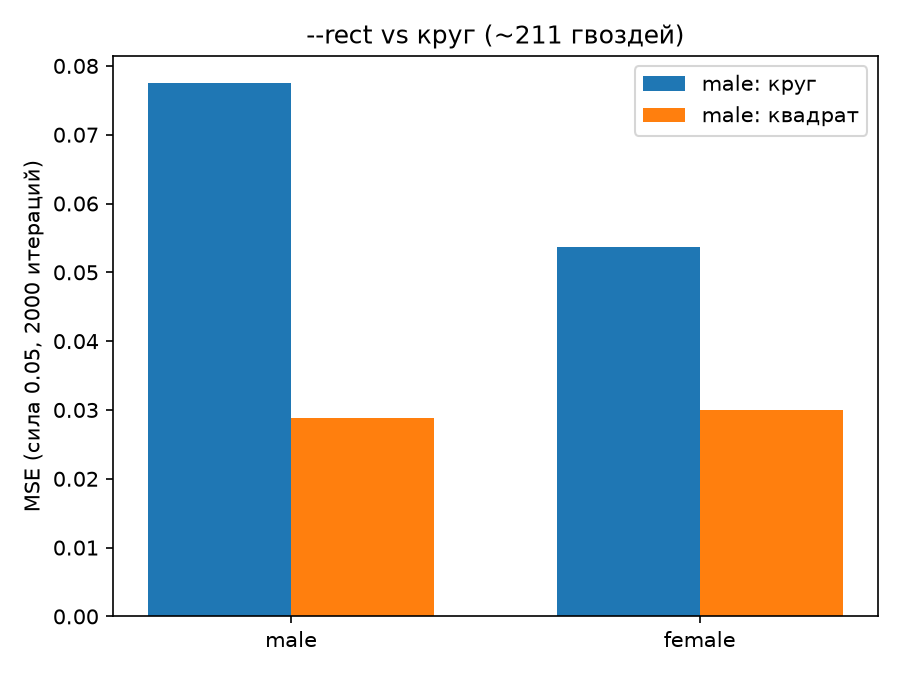
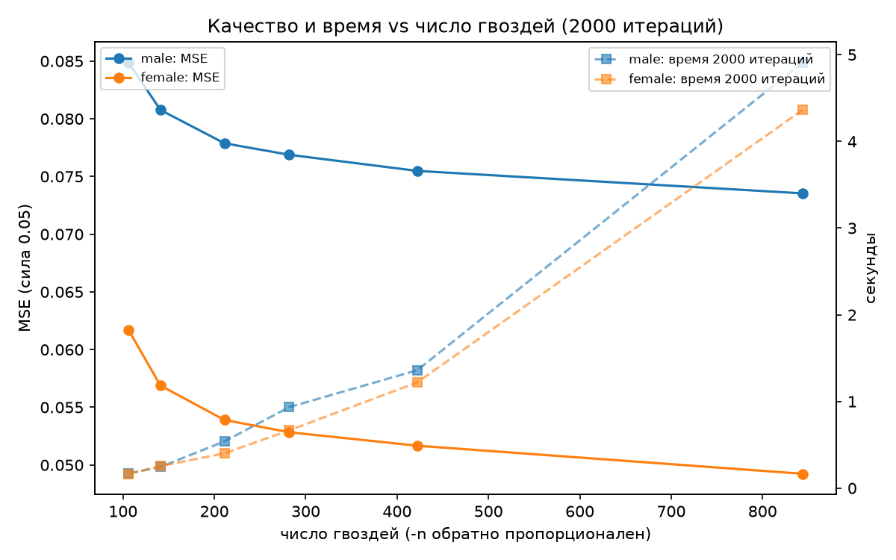
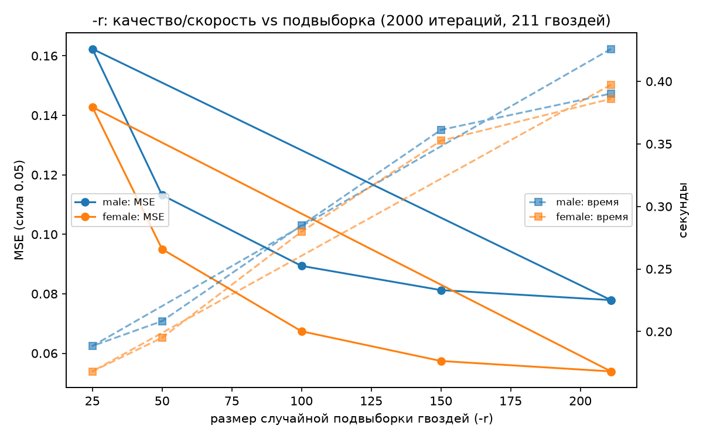
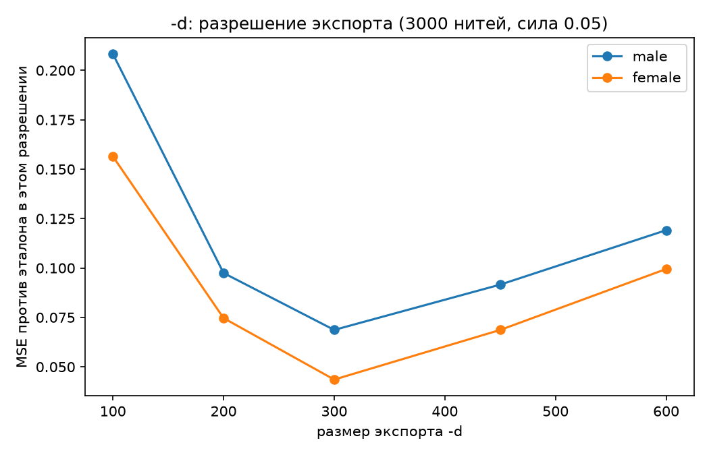
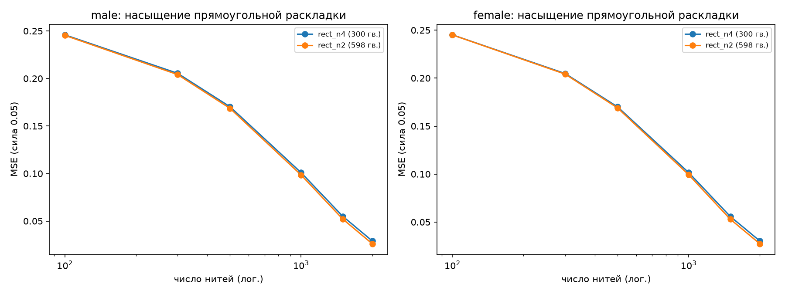
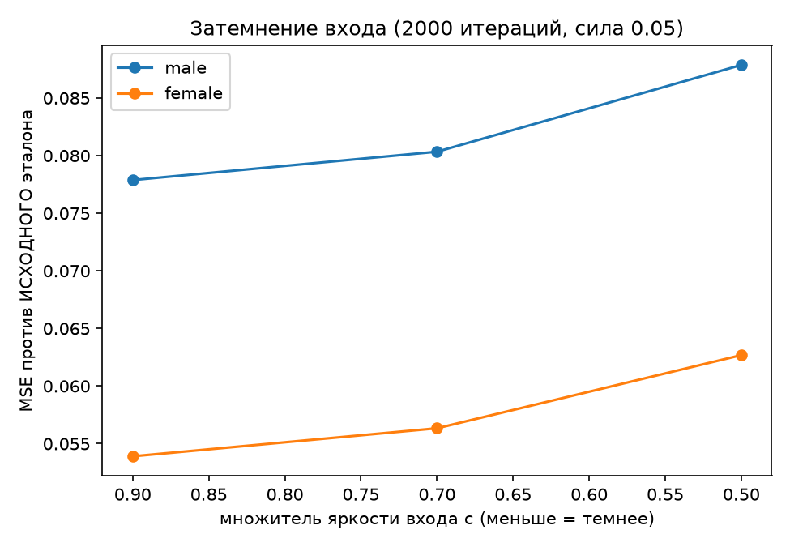

# Tuning guide

Every CLI flag, measured on face-centered portrait fixtures (`tests/data/`). Each section shows the rule, the numbers behind the rule and the degradation curve. Raw data sits in `docs/img/params/*.json`. Re-run any sweep with `uv run python scripts/parameter_sweep.py --sweep <name>`.

## Summary

| Flag | Recommended value | Rule |
|---|---|---|
| `--rect` | always on for square portraits | 1.8 to 2.7x lower error than the circle |
| `-s` | unset (auto) | auto fits 104/L to the actual pull count, clamped 0.03..0.2, within 2 percent of hand-tuned |
| `-l` | up to saturation, about 2500 to 2900 threads | beyond saturation the search finds no improvements |
| `-n` | 4 for the knee, 2 for maximum quality | 844 circle nails buy 6 percent error reduction at 4x the cost |
| `-r` | 100 to 150 while exploring, drop the flag for the final run | k=100 saves 40 percent of the time for 15 percent error |
| `-d` | 300 | exporting above the working grid hurts |
| `--weight` | 3.0 for portraits, off for other subjects | center MSE falls 24 to 28 percent, global MSE rises 3 percent |
| `--min-chord` | off | the greedy never picks short chords. Thresholds bite only past 230 px and cost up to 24 percent MSE |
| `--realistic` | on when exporting well above 300 px | 0.3 mm thread at a 400 mm board beats the hairline by 35 percent at the 1200 px export |
| `--palette` | cmyk for color runs | CMYK beats the RGB triple by 42 to 45 percent color MSE at an equal total budget |

## Thread count and export strength

By default the export strength is auto: the run waits for the search to finish, takes the actual pull count L and applies s = 104 / L, clamped to 0.03..0.2. The law and the constant come from the sweep below, fitted by `scripts/fit_export_strength.py` (least squares in log space over the uncensored points, k = 104.0, residual band x1.06). Measured anchors: the best hand-tuned strength is 0.2 at 500 pulls, 0.1 at 1000 and 0.05 at 2000. The resolver reproduces all three. On both portrait fixtures at 500 and 2000 pulls the auto render MSE sits within 2 percent of the hand-tuned optimum (`tests/test_e2e_real_photos.py`). The 0.2 ceiling: the sweep optimum tops out at 0.2 up to 500 pulls, and 0.3 measured worse than a blank canvas on synthetic fixtures. An explicit `-s` overrides the auto value and logs nothing.

Advanced: manual values. The working simulation darkens each pull with strength 0.05. The export accumulates with strength `-s`. When `-s` doubles the working strength, the render reaches its target around halfway and overshoots after.



With the default `-s 0.1` the optimum arrives near 1000 to 1500 threads, then the picture darkens past the reference. With `-s 0.05` the error falls monotonically until the search saturates.

At small budgets a stronger thread wins. At N=300, `s=0.2` gives MSE 0.141 against 0.215 for `s=0.05`. At N=2000 the ranking flips, 0.078 against 0.205.



Physical pieces in the 3000 to 7000 thread range need `-s 0.05`. See [research/pull-count-quality.md](research/pull-count-quality.md) for the full analysis.

## Nail layout



Rectangle nails cut error by 1.8 to 2.7x on square portraits: MSE 0.029 against 0.078 on the male fixture, 0.030 against 0.054 on the female fixture, both at 2000 iterations. Corner nails cover the edges of the face and hair. Use the circle only for round physical frames. Custom layouts (`--layout polygon:5`, `star:5:0.55`, `rings:...`, `svg:...`) are geometry plugins: the search and the saturation findings transfer unchanged, and the nail-count guidance below applies per layout (docs/layouts.md).

## Nail step



The quality curve has a knee at the default. Circle nails at 2000 iterations: 106 nails give MSE 0.085, 211 give 0.078, 422 give 0.076, 844 give 0.074. Four times the nails buy 6 percent. With `--rect` the payoff from density grows to 10 percent, see the saturation table below.

## Random subset



| k | MSE, male fixture | loss | role |
|---|---|---|---|
| full scan | 0.0779 | none | final run |
| 150 | 0.0812 | +4 percent | near-lossless |
| 100 | 0.0894 | +15 percent | interactive work, 40 percent faster |
| 50 | 0.1132 | +45 percent | rough draft |
| 25 | 0.1623 | about 2.1x | avoid |

The subset is drawn in the Rust core with a seeded splitmix64 sampler, so runs repeat exactly without numpy.

## Export resolution



MSE bottoms out exactly at the working grid, 300. Below 300 you lose detail. Above 300 the same thread pattern stretches over more pixels, the anti-aliased lines thin out and brighten, and error grows to 0.09 or worse. Keep `-d` at the working grid.

Searching above the working grid was measured too: 450 and 600 buy 0.1 to 2.6 percent MSE at up to 2.4x the time at the production working strength 0.05, under the pre-registered 3 percent bar (see [research/grid-scale-experiment.md](research/grid-scale-experiment.md)). `LONG_SIDE = 300` stands. Large grids only help when the working strength is mistuned and channels saturate early.

## Saturation



| Configuration | Nails | Saturation point | MSE at s=0.05 |
|---|---|---|---|
| circle `-n 4` | 211 | about 2860 to 2900 threads | 0.078 / 0.054 |
| rect `-n 4` | 300 | about 2500 to 2670 | 0.029 / 0.030 |
| rect `-n 2` | 598 | about 2530 to 2640 | 0.026 / 0.027 |

Every layout saturates in the same 2500 to 2900 thread band. Raising the iteration budget past saturation wastes time without adding threads.

## Input darkening

A published rule from Birsak et al. says darker inputs approximate better. Measured on this code base, the rule fails: c=0.9 gives MSE 0.054, c=0.7 adds 4 to 5 percent, c=0.5 adds 14 to 16 percent. The accumulate-and-clip model with explicit thread strength differs from their opaque clamp. Keep the built-in 0.9 factor.



## Importance weighting

`--weight <peak>` multiplies each pixel's error contribution by a Gaussian weight map centered on the image: peak at the center, 0.5 at the borders, sigma one third of the side length. Threads concentrate on the center and the periphery loses ink.

Measured on both portrait fixtures at 2000 threads (`--rect`, `-s 0.05`): center MSE inside the central 50 percent box falls 24 to 28 percent, global MSE rises about 3 percent, scan time grows about 25 percent. Use `--weight 3` for portraits. Leave the flag off for subjects without a single center of interest: landscapes, groups, text. Full tables: [research/alternatives-experiment.md](research/alternatives-experiment.md).

## Minimum chord

`--min-chord <px>` bans candidate chords shorter than the distance in working-grid pixels. Measured on both portrait fixtures at 2000 threads (`--rect`, `-s 0.05`): the unfiltered greedy already avoids short pulls. The natural minimum chord sits at 229.5 px on the male fixture and 148 px on the female fixture. Thresholds up to 200 px leave the pull order untouched, and at 300 px global MSE rises 13 to 24 percent. Keep the flag off. Full curve and the chord distribution: [research/min-chord-experiment.md](research/min-chord-experiment.md).

## Physical thread model

`--realistic` switches the render to threads of a physical width: `--thread-width` millimeters of thread on a `--canvas-size` millimeter board, scaled to the export. At the default 300 px export the width computes below 0.15 px and the render barely differs from the hairline. At large exports it matters: 0.3 mm on a 400 mm board (0.9 px at the 1200 px export) matches the hairline's double pull budget at 500 pulls and beats the hairline by 35 percent at 2000 pulls. The search never changes, only the render. Numbers: [research/thread-model-experiment.md](research/thread-model-experiment.md).

## Thread palettes

`--palette <name|file.json>` picks the thread colors: built-ins are `rgb` (the compatibility triple), `cmy` and `cmyk`; a path loads a JSON list of `{"name", "rgb": [r, g, b]}` entries (ship a subset you own, up to 8 threads; see `examples/palettes/dmc-starter.json`). `--rgb` stays as sugar for `--palette rgb` and wins if both are given. Measured at an equal total budget of 3000 pulls: cmyk improves color MSE 42 to 45 percent over rgb on both fixtures, cmy 37 to 40 percent. Color MSE scales with pulls per thread, so keep `total budget / threads` in the hundreds. Full tables: [research/palette-experiment.md](research/palette-experiment.md).

## Presets

```bash
# preview, ~0.3 s
uv run restring -i face.png -o out.png --rect -l 300

# balanced, ~0.6 s
uv run restring -i face.png -o out.png --rect -n 4 -l 2000

# maximum measured quality, ~1.4 s
uv run restring -i face.png -o out.png --rect -n 2 -l 3000

# physical winding preview: thread thickness from a real board
uv run restring -i face.png -o out.png --rect -n 2 -l 3000 --realistic --canvas-size 400 --thread-width 0.2
```

## RGB

The RGB pipeline inherits the layout, nail step and budget findings mechanically. Its own sweep (docs/research/rgb-channels-experiment.md) fixed the working strength at 0.05, down from 0.1: global color MSE improves 13 to 17 percent on both fixtures and channels stop saturating before the budget. Variance-proportional budgets and exhaustion stopping measured worse or neutral and stand rejected. Export stays auto per channel.

## Limits

The working grid above 300 is answered: keep 300 (research/grid-scale-experiment.md). Remaining open experiment: none tracked in the tuning guide.
