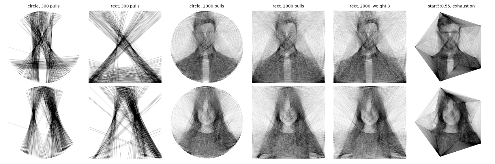

# Example gallery

Twelve deterministic renders over the two portrait fixtures, one montage per
configuration family. Every tile regenerates exactly from the command under
it — the greedy search has no randomness.



Configurations and per-tile numbers live in
[`docs/img/gallery.json`](../../docs/img/gallery.json); regenerate everything
with:

```bash
uv run python scripts/make_gallery.py
```

## The tiles

Column 1 — circle board, 300 pulls, fast preview strength:

```bash
restring -i photo.png -o out.png -l 300 -s 0.2
```

Column 2 — rectangle board, same budget (the rect nails concentrate nails on
the picture edges, see the tuning guide's layout section):

```bash
restring -i photo.png -o out.png --rect -l 300 -s 0.2
```

Column 3 — circle board, 2000 pulls at the fitted strength:

```bash
restring -i photo.png -o out.png -l 2000 -s 0.05
```

Column 4 — rectangle board, 2000 pulls (the balanced preset):

```bash
restring -i photo.png -o out.png --rect -l 2000 -s 0.05
```

Column 5 — importance weighting: threads concentrate on the face, the
background starves (`--weight 3`):

```bash
restring -i photo.png -o out.png --rect -l 2000 -s 0.05 --weight 3
```

Column 6 — star board from a T-13 layout spec, run to exhaustion (1500
requested, ~1000 distinct survive the pixel-grid dedupe):

```bash
restring -i photo.png -o out.png --layout star:5:0.55:1500 -s 0.05
```

## Boards you can wind

Every tile's `art.restring`-style instructions come from adding
`--project-out` to the same command, and the winding poster with nail numbers
and thread length from `--poster` (see the winding guide).
